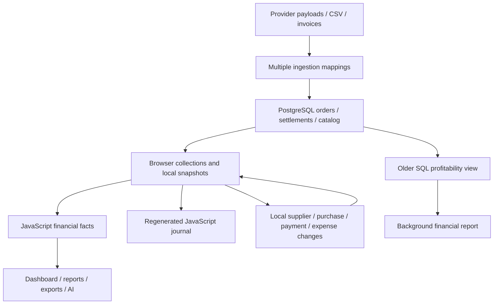

> Remediation follow-up (19 October 2026): this document preserves the original audit snapshot. Current implementation, verified fixes, guarded unsupported inputs and live release gates are recorded in [FINANCIAL_REPAIR_PROGRESS.md](./FINANCIAL_REPAIR_PROGRESS.md).

# MarginFlow — independent financial research and architecture review

**Review date:** 19 October 2026, Asia/Calcutta.  
**Reviewed:** the actual working tree, including the uncommitted calculation corrections.  
**Outcome:** material defects remain. The application is not ready to be described as 100% accurate, a complete statutory ledger, or audit-ready accounting software.

Three independent reviewers examined (1) calculations/accounting, (2) Indian tax rules, and (3) ingestion/persistence. The coordinating review independently exercised report exports, return rates, stock changes and claims through actual application functions. External material was used to verify rules and provider contracts, not copied as application implementation. No implementation fixes were made during this review.

The previous `CALCULATION_AUDIT.md` is an implementation log, not independent assurance. This review identifies remaining defects, including defects in paths affected by those corrections. Matching a requested formula, conserving paise and balancing debits against credits do not establish that transactions were complete, correctly valued or assigned to the right period.

## How to read the findings

**P1:** can materially misstate or lose financial information in a supported workflow. **P2:** narrower calculation, reconciliation, input or control problem. These are engineering priorities, not assertions that a particular merchant has committed a legal violation.

**Executed** means a synthetic fixture was passed through actual application exports, with HTTP/database/React boundaries mocked. **Source trace** means the relevant code and wiring establish the behavior, without executing a live database or provider. **Conditional compliance gap** means the code lacks evidence/control needed for a legal treatment; the merchant's actual liability depends on its registration, entity, invoice and filing facts.

## Highest-priority findings

| Finding | Concrete effect | Actual code evidence | Supporting review |
| --- | --- | --- | --- |
| **P1 — Browser-only books and invalid saved snapshots** | Orders, products and settlements are refreshed from the server, while ordinary supplier/purchase/payment/expense/return/claim CRUD remains local. Some stock/status changes disappear after refresh. Supplier audit events are excluded from the snapshot validator, causing the entire saved ledger to be rejected on rehydration. | [store.tsx:303](</C:/Users/freak/Desktop/Unified platform/src/domain/store.tsx:303>), [store.tsx:1448](</C:/Users/freak/Desktop/Unified platform/src/domain/store.tsx:1448>), [snapshot-validation.ts:60](</C:/Users/freak/Desktop/Unified platform/src/domain/snapshot-validation.ts:60>) | Architecture A1–A2 |
| **P1 — A colliding generated order ID can replace another order** | Invoice approval generates a repeating four-digit display ID. Persistence prioritizes display-ID identity even when the incoming external channel order ID differs. The actual probe updated the original order UUID to the second channel order and deleted its old lines, instead of inserting/rejecting. | [store.tsx:1573](</C:/Users/freak/Desktop/Unified platform/src/domain/store.tsx:1573>), [order-persistence.ts:98](</C:/Users/freak/Desktop/Unified platform/src/lib/integrations/order-persistence.ts:98>), [order-persistence.ts:184](</C:/Users/freak/Desktop/Unified platform/src/lib/integrations/order-persistence.ts:184>) | Architecture A17 |
| **P1 — Imported zero COGS becomes immutable** | Connectors post `snapshotUnitCost: 0`; persistence resolves categories, not historical costs. A delivered ₹100 line can report ₹100 contribution despite a matching catalog cost. Subsequent updates retain the zero snapshot. Product history/aliases supplied to the catalog API are also not written. | [order-persistence.ts:104](</C:/Users/freak/Desktop/Unified platform/src/lib/integrations/order-persistence.ts:104>), [order-persistence.ts:243](</C:/Users/freak/Desktop/Unified platform/src/lib/integrations/order-persistence.ts:243>), [products/route.ts:124](</C:/Users/freak/Desktop/Unified platform/src/app/api/products/route.ts:124>) | Architecture A3, A13 |
| **P1 — A fee-dispute recovery can erase a legitimate sale** | A delivered ₹100 sale with ₹40 COGS has ₹60 contribution. Recording a ₹5 recovered FEE_DISPUTE changes the order to CLAIM_APPROVED; status-only return inference removes all sales. Actual output becomes net sales ₹0 and contribution **−₹35**, with no return record. The sale should remain recognized; adding the recovery would give ₹65 contribution under the app's existing recovery convention. | [store.tsx:1139](</C:/Users/freak/Desktop/Unified platform/src/domain/store.tsx:1139>), [order-financials.ts:58](</C:/Users/freak/Desktop/Unified platform/src/domain/order-financials.ts:58>) | Coordinating executed probe |
| **P1 — Economic events disappear or move to the wrong reporting period** | An October settlement/return for a September order is retained by the date filter but ignored by business profitability because its parent order was filtered out. Current RETURNED status can instead erase the September sale when the actual return happened in October. Placement date is also used for recognition journals. | [profitability-engine.ts:653](</C:/Users/freak/Desktop/Unified platform/src/domain/profitability-engine.ts:653>), [profitability-engine.ts:286](</C:/Users/freak/Desktop/Unified platform/src/domain/profitability-engine.ts:286>), [ledger-engine.ts:285](</C:/Users/freak/Desktop/Unified platform/src/domain/ledger-engine.ts:285>) | Calculation C1–C2; Tax T7 |
| **P1 — Amazon shipment events are treated as bank cash and can overwrite each other** | A shipment posting is marked RECONCILED without an independent payout/bank match. Refund/adjustment collections are ignored. Two same-order/date shipment nets of ₹90 and ₹45 collide on the persistence key; the second replaces the first rather than preserving ₹135. | [amazon/finances/route.ts:220](</C:/Users/freak/Desktop/Unified platform/src/app/api/integrations/amazon/finances/route.ts:220>), [amazon/finances/route.ts:297](</C:/Users/freak/Desktop/Unified platform/src/app/api/integrations/amazon/finances/route.ts:297>), [order-persistence.ts:415](</C:/Users/freak/Desktop/Unified platform/src/lib/integrations/order-persistence.ts:415>) | Architecture A7–A8 |
| **P1 — Other source imports also lose or invent money** | Shopify discount allocations/refunds/cancellation evidence and WooCommerce fee/refund evidence are stripped. Generic sync treats order total ₹200 with quantity 2 as unit price ₹200, producing ₹400 gross sales. Currency is discarded, so USD 100 can be displayed as INR 100. Flipkart promotion/status mappings are incomplete. | [shopify-schema.ts](</C:/Users/freak/Desktop/Unified platform/src/lib/webhooks/schemas/shopify-schema.ts>), [woocommerce-schema.ts](</C:/Users/freak/Desktop/Unified platform/src/lib/webhooks/schemas/woocommerce-schema.ts>), [generic/sync/route.ts:187](</C:/Users/freak/Desktop/Unified platform/src/app/api/integrations/generic/sync/route.ts:187>) | Architecture A4–A6, A11–A12 |
| **P1 — Invoice approval still invents posting facts** | A full multi-line invoice is collapsed into its first item. Approval uses hard-coded unit cost ₹380, a fallback demo SKU, and, for supplier bills, a demo supplier and PAID status. The approval function itself does not enforce complete arithmetic/catalog/status prerequisites. | [idp-pipeline.ts:89](</C:/Users/freak/Desktop/Unified platform/src/domain/idp-pipeline.ts:89>), [store.tsx:1565](</C:/Users/freak/Desktop/Unified platform/src/domain/store.tsx:1565>), [store.tsx:1622](</C:/Users/freak/Desktop/Unified platform/src/domain/store.tsx:1622>) | Architecture A10 |
| **P1 — Background reports run a different financial engine** | The live report job queries a SQL view still containing `gross_sales * 0.75`. For gross ₹100 and cost ₹20 without receipts, that path produces ₹55 profit, while the current JS engine produces ₹80 before unknown fees and withholds the payout forecast. | [job-processors.ts:40](</C:/Users/freak/Desktop/Unified platform/src/lib/queue/job-processors.ts:40>), [initial_schema.sql:1067](</C:/Users/freak/Desktop/Unified platform/production-supabase/migrations/20261017000100_initial_schema.sql:1067>) | Architecture A9; source trace, not live SQL execution |
| **P1 — Cash and receivables do not reconcile across accepted input paths** | A correctly netted ₹490 bank settlement becomes ₹480 in the Net Platform Payout card after a ₹10 return fee is deducted again. Separately, a manual ₹1,000 `order.settlementAmount` counts as received cash and settled status but generates no bank journal, leaving the ledger receivable open. | [profitability-engine.ts:312](</C:/Users/freak/Desktop/Unified platform/src/domain/profitability-engine.ts:312>), [order-financials.ts:145](</C:/Users/freak/Desktop/Unified platform/src/domain/order-financials.ts:145>), [ledger-engine.ts:298](</C:/Users/freak/Desktop/Unified platform/src/domain/ledger-engine.ts:298>) | Calculation C4–C5 |
| **P1 — Salvage can manufacture inventory gains** | Damaged returned merchandise costing ₹100 with estimated salvage ₹500 creates inventory ₹500, salvage income ₹500 and contribution **+₹400**. If this is an estimate, inventory cannot be increased above its applicable cost basis. If it is actual sale proceeds, it needs an actual disposal transaction rather than an inventory debit. | [order-financials.ts:36](</C:/Users/freak/Desktop/Unified platform/src/domain/order-financials.ts:36>), [ledger-engine.ts:361](</C:/Users/freak/Desktop/Unified platform/src/domain/ledger-engine.ts:361>) | Calculation C3; [official ICAI AS 2](https://indasaccess.icai.org/Volume-III/AS/asb.html?a=105) |
| **P1 — Purchase ITC and unresolved price bases still produce definite tax journals** | ₹180 purchase GST is posted as eligible ITC with no recipient/eligibility evidence. An order with unknown inclusive/exclusive basis correctly withholds its payout forecast, but the ledger still posts an exclusive-price interpretation: price ₹1,180 plus GST ₹180 becomes receivable ₹1,360. | [ledger-engine.ts:395](</C:/Users/freak/Desktop/Unified platform/src/domain/ledger-engine.ts:395>), [ledger-engine.ts:214](</C:/Users/freak/Desktop/Unified platform/src/domain/ledger-engine.ts:214>) | Tax T1, T3 |
| **P1 — Split GST can be lost during CSV mapping** | A valid row containing CGST ₹90 and SGST ₹90 maps to one `taxAmount` of ₹90 without warning. The single-field alias selection loses a component. For a verified ₹1,180 inclusive invoice, this can overstate revenue by ₹90 and understate output GST by ₹90. | [csv-auto-mapper.ts:35](</C:/Users/freak/Desktop/Unified platform/src/domain/csv-auto-mapper.ts:35>), [csv-auto-mapper.ts:369](</C:/Users/freak/Desktop/Unified platform/src/domain/csv-auto-mapper.ts:369>) | Tax T2 |

## Additional independently executed workflow findings

The evidence files and runnable probes are [consumer findings](</C:/Users/freak/Desktop/Unified platform/financial-review-2026-10-19/reproduce-consumer-findings.cjs>), [consumer outputs](</C:/Users/freak/Desktop/Unified platform/financial-review-2026-10-19/root-probes.json>), [store findings](</C:/Users/freak/Desktop/Unified platform/financial-review-2026-10-19/reproduce-store-findings.cjs>) and [store outputs](</C:/Users/freak/Desktop/Unified platform/financial-review-2026-10-19/store-probes.json>). Run either script from the workspace with Node. They call the current application modules and do not connect to a live database.

### U1 — P1: the displayed/exported P&L does not reconcile

The actual ReportsView export for a two-unit sale with one damaged return contains net sales ₹100, COGS −₹80, gross profit ₹20, Return & RTO Losses −₹40, and contribution profit **₹20**. Its published formula instead gives **−₹20**. The damage cost is already retained in COGS and is listed again as a further loss. The statement also lacks complete explicit shipping/salvage/revenue-adjustment bridges.

For RTO shipping of ₹20, the engine exposes `returnLosses=20` and `rtoLosses=20`, while the dashboard, P&L export and AI serializer add both and display **₹40**. Core contribution is correctly −₹20 for this fixture, making the UI/AI explanation contradict the result.

Evidence: [reports-view.tsx:291](</C:/Users/freak/Desktop/Unified platform/src/components/modules/reports-view.tsx:291>), [reports-view.tsx:941](</C:/Users/freak/Desktop/Unified platform/src/components/modules/reports-view.tsx:941>), [ai-context.ts:191](</C:/Users/freak/Desktop/Unified platform/src/domain/ai-context.ts:191>), [dashboard-view.tsx:957](</C:/Users/freak/Desktop/Unified platform/src/components/modules/dashboard-view.tsx:957>). The report labels itself “GAAP Ledger” and “Audit-ready” at lines 863–866; those claims are not supported by these outputs.

**Correction direction:** define mutually exclusive bridge components, show refunded sales and the applicable tax/shipping adjustments, avoid subtracting damaged COGS a second time, and reconcile every displayed/exported total to the same projection. Do not change a correct headline merely to match an incorrect explanatory waterfall.

### U2 — P1: stock mutations and financial return classification disagree

- Adding a USED return increases stock from **9 to 10**, marks it RESTOCKED, while financial facts still classify one damaged unit and retain its COGS.
- Adding a SELLABLE but PENDING_RESTOCK return leaves stock at 9; editing it to DAMAGED reduces stock to **8**, although no prior restock occurred.
- Archiving an unshipped PENDING order increases stock from **9 to 10**, despite no shipment deduction being part of the fixture.
- The record-return action discards a recorded RTO customer fee: entered **₹5**, stored **₹0**. The core calculation would count a recorded fee, so the accepted business policy is not implemented end to end.
- An actual addOrder probe with two distinct lines of the same SKU, quantities 2 and 3, changes stock **10 → 8**, instead of **10 → 5**. The mutation uses only the first `.find` match ([store.tsx:678](</C:/Users/freak/Desktop/Unified platform/src/domain/store.tsx:678>)); financial COGS can nevertheless include both lines.

Evidence: [store.tsx:841](</C:/Users/freak/Desktop/Unified platform/src/domain/store.tsx:841>), [store.tsx:847](</C:/Users/freak/Desktop/Unified platform/src/domain/store.tsx:847>), [store.tsx:978](</C:/Users/freak/Desktop/Unified platform/src/domain/store.tsx:978>), [recycle-bin.ts:24](</C:/Users/freak/Desktop/Unified platform/src/domain/recycle-bin.ts:24>). The stock mutation branches do not consistently use the shared condition/type rules, prior posting state or bounded stock movements.

**Correction direction:** post and reverse identified stock movements atomically. A status/condition edit must change only movements that actually happened. Source-specific inventory evidence is required before inferring that a refund returned physical sellable stock.

### U3 — P2: reported return percentages use incompatible numerators

For one delivered order with two SKU lines and two valid one-unit return records, the actual engine unit-return rate is **100%**, but the reports chart supplies **200%**. It divides return-record count by order count. Neither a unique-order return rate nor a unit-return rate should be 200% for this fixture. Other report rows divide records by units, introducing another basis under the same generic label.

Evidence: [reports-view.tsx:69](</C:/Users/freak/Desktop/Unified platform/src/components/modules/reports-view.tsx:69>), [reports-view.tsx:108](</C:/Users/freak/Desktop/Unified platform/src/components/modules/reports-view.tsx:108>), [reports-view.tsx:138](</C:/Users/freak/Desktop/Unified platform/src/components/modules/reports-view.tsx:138>). Decide and label whether a rate concerns distinct orders, units or return events; use matching populations and bounded quantities.

### U4 — P2: further consumer precision and provenance problems

- The SKU drawer rounds each monetary per-unit component to whole rupees before displaying and copying the summary ([sku-drawer.tsx:54](</C:/Users/freak/Desktop/Unified platform/src/components/modals/sku-drawer.tsx:54>)). Separate rounded components need not reconcile, and paise are lost from the claimed unit economics.
- Monthly revenue charts add gross sales while other reports use net sales; the series needs an explicit gross-versus-net contract ([reports-view.tsx:178](</C:/Users/freak/Desktop/Unified platform/src/components/modules/reports-view.tsx:178>)).
- The AI context renames SKU/channel contribution as `netProfit` and does not carry the unknown-fee/tax-basis uncertainty alongside those values ([ai-context.ts:134](</C:/Users/freak/Desktop/Unified platform/src/domain/ai-context.ts:134>)). A deterministic answer can therefore repeat the wrong classification or an incomplete profit figure without explaining its evidence status.
- A manually saved settlement receives an invented `CMS-HDFC-...` bank reference, not a source UTR ([settlements-view.tsx:99](</C:/Users/freak/Desktop/Unified platform/src/components/modules/settlements-view.tsx:99>)). A generated internal reference must not masquerade as evidence of a bank transaction.

## Remaining findings covered by the specialist reports

Read these reports for exact line references, reproductions and correction directions:

- [Calculation/accounting review](</C:/Users/freak/Desktop/Unified platform/CALCULATION_RESEARCH_REVIEW.md>): duplicated claim attribution across returns; disagreement between aging and anomaly radar; false critical warnings for legitimate duplicate-SKU lines; omitted B2B Wholesale/Other channel totals; incomplete fee-evidence replacement; limits of current cost/stock/opening-balance models.
- [Tax review](</C:/Users/freak/Desktop/Unified platform/TAX_RESEARCH_REVIEW.md>): return GST credit-note eligibility/deadlines; separate tax-point versus revenue dates; historical COVID TDS reduction; missing current rate choices in purchase entry; applicability thresholds and withholding event dates; separate GST TCS and income-tax TDS reconciliation.
- [Architecture/ingestion review](</C:/Users/freak/Desktop/Unified platform/ARCHITECTURE_RESEARCH_REVIEW.md>): full provider contracts and line identity; stale webhook regression despite delivery deduplication; incomplete financial edit history; 2,000-record hydration truncation; unacknowledged settlement writes; per-row settlement batch commits; lost cost history and SKU aliases.

## Official rules and their actual implications

| Official benchmark | What it establishes | Code implication and applicability limit |
| --- | --- | --- |
| [ICAI AS 2](https://indasaccess.icai.org/Volume-III/AS/asb.html?a=105), especially paragraphs 5, 7 and 16 | Ordinary inventory measurement uses lower of cost and NRV, and cost treatment depends on tax recoverability and an appropriate cost-assignment method. | A positive salvage input is not automatically earned revenue or an unrestricted inventory increase. A preserved snapshot must still come from an evidenced cost policy. |
| [ICAI AS 9](https://indasaccess.icai.org/Volume-III/AS/asb.html?a=110), paragraphs 6.1 and 11 | Sale recognition depends on the relevant transfer of property/risks and rewards and evidence of consideration. | Order placement/current status alone does not establish the right revenue period. Ind AS entities require their applicable control-transfer analysis instead; entity applicability is not assumed. |
| [CBIC accounts/electronic-record rules](https://cbic-gst.gov.in/accnt-record-rules.html) | Registered-person records require appropriate stock/advance/tax evidence, edit/delete logs, backup and source-to-account linkage. | Browser-only mutable data, generic audit messages and unreconciled stock changes do not demonstrate these controls. This code review cannot verify deployed backups or retention. |
| [ICAI official audit-trail guidance](https://cajournal.icai.org/article-details/audit-trail-requirements-responsibilities) describing Companies (Accounts) Rule 3(1) | Companies maintaining books in accounting software have transaction/edit-log requirements effective from FY beginning 1 April 2023. | Immutable audit rows help, but a status-only record saying PREVIOUS does not prove a complete financial edit log. This company-law requirement is conditional on entity/use; it is not automatically imposed on every sole trader or LLP. |
| [CGST Section 16](https://taxinformation.cbic.gov.in/content-page/explore-act/1000285/1000001), with Sections 10 and 17 in the tax review | ITC has substantive eligibility and evidence conditions; regular registration alone does not settle every credit. | Purchase tax cannot universally be treated as recoverable credit. Fee credit described as provisional is not proof of an admissible filed claim. |
| [CGST Section 34](https://taxinformation.cbic.gov.in/content-page/explore-act/1000304/1000001) | Commercial refund and an admissible reduction of output GST are separate questions, including credit-note requirements and time limits. | Returning units must not automatically establish the right to reduce statutory GST payable. The report does not assert that every commercial refund is invalid. |
| [Income-tax Act 2025, Section 393(1), Table 8(v)](https://www.incometaxindia.gov.in/w/section-393-5) | The current ordinary e-commerce TDS rate is 0.1%, subject to the Act's other provisions. | The ordinary rate currently used is correct. Participant eligibility, thresholds and the earlier credit/payment event remain necessary; old 194-O naming alone is not a rate error. |
| [CBDT historical Section 197B](https://www.incometaxindia.gov.in/w/section-197b-7) | The historical temporary rate reduction includes the relevant initial 194-O interval. | The table's 1% assumption in October 2020–March 2021 gives false warnings; 0.75% is the relevant ordinary interval identified in the tax review. |
| [GST Notification 15/2024-CT](https://gstcouncil.gov.in/sites/default/files/2024-09/central-tax-15-2024-11072024.pdf), with corresponding state/IGST treatment documented in the tax review | Supports the reduction in ECO GST TCS. | The current ordinary **combined 0.5%** is supported; a central-tax component alone must not be mistaken for the aggregate rate. Eligibility, bases and official-credit reconciliation still need evidence. |

Provider interpretations were checked against official Shopify Order/Refund/webhook guidance, WooCommerce orders/refunds documentation, Amazon's published SP-API model and financial-event-group workflow, and Flipkart's order-management reference. The architecture review links each contract next to the specific mapping defect. No third-party blog or copied calculation is the basis for a confirmed finding.

## Architecture assessment

The current implementation has several competing representations of financial truth:

The same numbers do not retain consistent meaning across these paths. Durable source events, browser balances, ledger postings, period projections and explanatory UI must reconcile; currently they do not. The application has useful components for an operational finance tool, but the inspected implementation is insufficient as the sole system of statutory books.

The chart also does not provide a complete opening cash/inventory/payable/equity system, a demonstrated inventory valuation method, locked accounting periods, or complete tax-credit utilization reconciliation. Those are scope/architecture boundaries, not a claim that every missing enterprise feature is legally mandatory for every tenant.

## Functionality coverage

| Functionality traced | Outcome |
| --- | --- |
| Decimal rounding, monetary allocation, exact balance checking | Useful controls; no counterexample established within the tested supported range. |
| Delivered/cancelled/pending orders, partial and damaged returns | Core bounded quantities improved; lifecycle, date and stock integration defects confirmed. |
| Manual sales and recorded settlement amounts | Cash/journal mismatch and claim-driven status defect confirmed. |
| Fee rules, quick rates, actual deduction replacement, fee GST | Paise arithmetic/versioning useful; evidence completeness and tax eligibility need further controls. |
| Supplier intake, partial payments, advances, snapshot export/import | Allocation helpers useful; durability and schema compatibility fail end to end. |
| Product stock, costs, history, SKU aliases | Snapshot/history intent useful; history/alias persistence and physical stock movements incomplete. |
| Amazon, Shopify, WooCommerce, Flipkart, generic ingestion | Financial source mapping defects confirmed; no live partner API acceptance certification. |
| Meesho and Myntra direct synchronization | The inspected sync routes explicitly return HTTP 501 for unavailable direct sync; these paths are not implemented integrations. CSV imports use the shared import paths reviewed above. |
| CSV and invoice/OCR approval | Split tax loss, multi-line loss and invented posting facts confirmed. |
| Claims and reimbursements | Attribution and fee-dispute lifecycle errors confirmed. |
| Cash payout, receivables, settlement aging, anomaly radar | Multiple contradictory outcomes confirmed. |
| Period/channel reporting, SKU/channel totals and P&L CSV | Cross-period loss, omitted channels, inconsistent bridge and rates confirmed. |
| AI financial explanations | Inherits duplicate losses, contribution/net-profit naming and missing uncertainty context. |
| Recycle/archive/restore | Transactional archive exists; stock inference can be wrong and restore windows are not proof of statutory retention. |
| Webhooks, jobs and API persistence | Useful transaction/deduplication/lease controls; stale events, report model and batch acknowledgement gaps remain. |
| Tenant ownership and access boundaries | Owner-scoped patterns observed; no cross-tenant leak established. This is not a complete security penetration test. |
| GST/ITC/TCS/TDS, invoice/tax timing, source records | Ordinary current rates partly verified; comprehensive filing eligibility and reconciliation are not implemented/proven. |

## Verification and limits

Fresh repository run: **299 tests, 276 passing, 23 failing**. [Raw test log](</C:/Users/freak/Desktop/Unified platform/financial-review-2026-10-19/current-test-run.log>). The earlier implementation run had the same counts. Some failing tests concern the older authentication architecture; failures are not automatically proof of a current vulnerability. Conversely, a passing suite does not cover the confirmed cross-component and accounting-rule counterexamples in this review. The suite's own TypeScript-check test passed; no new application build or deployment was needed for this review because implementation was not changed.

No production database, actual bank statement, original merchant invoice/credit note, tax registration, GSTR/26AS statement, deployed migration state, backup restore or complete transaction population was inspected. Web research cannot supply these merchant-specific facts. Therefore neither transaction-level certification nor a universal compliance assertion is possible from this review. The findings above already establish that the present code is not wholly correct, independently of those missing records.

## Corrective order

1. **Protect and reconcile financial evidence first:** make saved supplier/purchase/payment/return/claim/expense records durable, repair snapshot compatibility, acknowledge successful writes, preserve full source identities and revisions, and resolve hydration truncation. Retain source documents and backups before any data repair.
2. **Fix posting inputs and events:** historical costs, exact line values, discount/refund/fee/currency semantics, independent Amazon payout evidence and collision-safe event identities. Remove invented invoice cost/vendor/payment facts. Keep fulfillment, commercial refund, GST adjustment and cash events distinct.
3. **Unify projections:** one verified event-based model must drive JS reports, SQL jobs, ledger, payout cards, anomaly radar, exports and AI. Explicitly separate order-cohort reports from event-period cash/accounting reports. Stop fee claims from changing physical-return status.
4. **Correct accounting classification:** apply a supported inventory cost/NRV policy, distinguish estimated salvage from actual disposal proceeds, gate recoverable purchase taxes, and reconcile stock and cash against their posting journals.
5. **Complete applicable tax/recordkeeping controls:** invoice/tax-point dates, admissible GST credit notes, eligible/provisional/blocked/reversed ITC, dated rates and applicability, separate withholding-credit reconciliation, edit history and verifiable retention/backup controls. Have the merchant's CA determine actual framework and registration applicability using original records.
6. **Prove complete workflows:** provider payload → validated canonical event → committed record/movement → journal → period report → CSV/AI, then bank/invoice/stock reconciliation. Include the counterexamples in this review, duplicate/reordered/stale events, reopen/refresh/new-browser behavior and data beyond a single API page.

This review supplies findings and priorities. It intentionally does not apply fixes, alter financial records or claim a statutory audit opinion.
