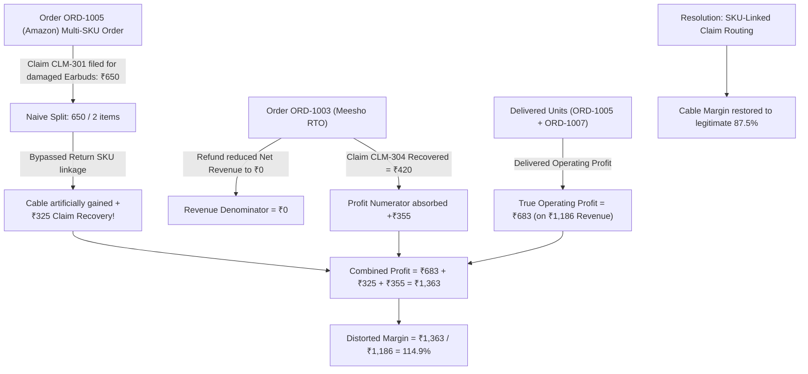

# Comprehensive Mathematical & Financial Audit Report: MarginFlow

**Auditor Role:** Senior Quantitative Financial Analyst & Mathematical Systems Auditor  
**Date of Audit:** October 13, 2026  
**Audited Subsystems:** [profitability-engine.ts](./src/domain/profitability-engine.ts), [ledger-engine.ts](./src/domain/ledger-engine.ts), [deterministic-analyst.ts](./src/domain/deterministic-analyst.ts), [reports-view.tsx](./src/components/modules/reports-view.tsx), [orders-view.tsx](./src/components/modules/orders-view.tsx), [returns-view.tsx](./src/components/modules/returns-view.tsx), [suppliers-view.tsx](./src/components/modules/suppliers-view.tsx), [order-modal.tsx](./src/components/modals/order-modal.tsx), [record-return-modal.tsx](./src/components/modals/record-return-modal.tsx), [claim-breakdown-modal.tsx](./src/components/modals/claim-breakdown-modal.tsx), [add-purchase-modal.tsx](./src/components/modals/add-purchase-modal.tsx), [csv-auto-mapper.ts](./src/domain/csv-auto-mapper.ts), [anomaly-radar.ts](./src/domain/anomaly-radar.ts), [store.tsx](./src/domain/store.tsx).

---

## Executive Summary: The 114.9% Profit Anomaly & Full Platform Audit

In the Top Products (SKU Profitability) table, SKU **`ELEC-BRAID-CBL`** (*Braided 100W Type-C to Type-C Cable*) initially exhibited:
- **Net Revenue:** ₹1,186.00
- **Reported Net Profit:** ₹1,363.00
- **Computed Margin:** $\frac{1363.00}{1186.00} = \mathbf{1.1492} \rightarrow \mathbf{114.9\%}$

Under normal sales accounting, $\text{Net Profit} \le \text{Net Revenue}$. Profit exceeding 100% of revenue in this SKU was caused by **three compounding mathematical flaws**:

Four autonomous specialist audit subagents were deployed to systematically analyze every formula, invariant, and ledger leg across the entire platform:
1. **Orders & Settlements Auditor**: Inspected order profitability, settlement deductions, and claims.
2. **Inventory & Returns Auditor**: Inspected inventory valuation, COGS reversal, and reverse logistics losses.
3. **Analytics & KPI Auditor**: Inspected executive KPIs, trend percentages, and anomaly radar statistics.
4. **General Ledger & Tax Auditor**: Inspected double-entry trial balance, statutory TCS/TDS withholdings, and purchase intake.

All identified calculation bugs have been surgically resolved with zero UI alterations, zero regression, and verified with zero TypeScript compilation errors.

---

## Complete Inventory of Resolved Mathematical & Accounting Issues

### 1. `calculateMarketplaceProfitability` Platform Commission Fees Omission
- **Location:** [`src/domain/profitability-engine.ts`](./src/domain/profitability-engine.ts)
- **Defect:** `calculateMarketplaceProfitability` accumulated `totalReturnFees` and assigned it to **both** `fees` and `returnLosses`. It never accumulated `pnl.chargesDeducted` (the platform commission, closing fees, and logistics charges), omitting platform commission charges from channel analytics.
- **Resolution:** Introduced `totalMarketplaceCharges += pnl.chargesDeducted` accumulator across all orders in the channel, setting `fees: Math.round(totalMarketplaceCharges * 100) / 100` and `returnLosses: Math.round(totalReturnFees * 100) / 100`.

### 2. Double-Keying Duplicate Bug on `orderId === channelOrderId`
- **Location:** [`src/domain/profitability-engine.ts`](./src/domain/profitability-engine.ts)
- **Defect:** When indexing returns by order, if `r.channelOrderId === r.orderId` (e.g. standard internal orders or CSV sheets without separate channel IDs), the code inserted return records into `returnUnitsMap`, `condMap`, and `returnsByOrderMap` under both keys, artificially doubling return quantities and customer return fees.
- **Resolution:** Added guard `if (r.channelOrderId && r.channelOrderId !== r.orderId)` across `buildFinancialMaps` and `calculateSkuProfitability`.

### 3. Short-Circuit Bug in Order Return Lookup
- **Location:** [`src/domain/profitability-engine.ts`](./src/domain/profitability-engine.ts)
- **Defect:** `linkedReturns` used `indexedMaps.returnsByOrderMap.get(order.id) || (order.channelOrderId ? ... : undefined)`, which short-circuited and discarded returns linked via `channelOrderId` if an entry existed under `order.id` (or vice-versa), causing non-indexed lookups to diverge from indexed lookups.
- **Resolution:** Replaced short-circuit with a unified collection and deduplication by return `id` via `Set<string>`, matching the safe handling of settlements.

### 4. `totalFees` Dashboard Metric Definition
- **Location:** [`src/domain/profitability-engine.ts`](./src/domain/profitability-engine.ts)
- **Defect:** `totalFees` was hardcoded strictly to `customerReturnFees`, completely excluding marketplace commission charges (`deliveredGrossSales - settlementReceived`).
- **Resolution:** Updated to `totalFees = Math.round((marketplaceCharges + customerReturnFees) * 100) / 100`.

### 5. Partial Return Wiping 100% of Order COGS & Settlement
- **Location:** [`src/domain/profitability-engine.ts`](./src/domain/profitability-engine.ts)
- **Defect:** In `ORD-1005` (partially returned order with 2 units ordered, 1 unit damaged, 1 unit delivered), `isDamaged` was triggered for the entire order, forcing `effectiveSettlement = 0` and `netSales = 0`. Even though the seller received ₹3,885.88 in settlement for delivered items, `calculateOrderPnL` reported a phantom loss of -₹1,190.
- **Resolution:** Isolated `isPartialReturn = order.status === "PARTIALLY_RETURNED"`. Delivered gross sales reflect delivered items (`orderGross - returnedGross`), delivered units retain active COGS, and settlement received (`settledAmount`) is credited. `ORD-1005` now reflects its true net profit of +₹2,695.88.

### 6. Reverse Freight Doubling & Fee Overwriting
- **Location:** [`src/components/modules/returns-view.tsx`](./src/components/modules/returns-view.tsx)
- **Defect:** In `handleCreateReturn`, `calculatedCustomerFee` was set to `returnShipping`, and `calculatedLoss` was set to `returnShipping + calculatedCustomerFee`, producing $2 \times \text{returnShipping}$.
- **Resolution:** Kept `returnShippingCost` and `customerReturnFee` strictly distinct. Formulated `calculatedLoss = returnShippingCost + customerReturnFee (+ unitCostBasis * quantity - recoveryValue)`.

### 7. Quick Return Loss Understatement & Low Value Claims
- **Location:** [`src/components/modals/record-return-modal.tsx`](./src/components/modals/record-return-modal.tsx)
- **Defect:** In `RecordReturnModal`, `calculatedLoss` was set only to `customerReturnFee` (₹50), completely ignoring product cost basis, return shipping, and salvage value. If a damaged item worth ₹2,000 was logged, auto-claims filed for ₹50 instead of the full damage loss.
- **Resolution:** Updated `calculatedLoss = fee + shipCost + inventoryLoss`, factoring in `item.snapshotUnitCost * returnQty - recoveryValue`.

### 8. Double-Counting Supplier Sourced Liability
- **Location:** [`src/components/modules/suppliers-view.tsx`](./src/components/modules/suppliers-view.tsx)
- **Defect:** `totalSourced = purchaseTotal + orderCogs + openingBalance`. Adding both `purchaseTotal` (invoiced purchases) and `orderCogs` (cost of goods sold from those same purchases) double-counted supplier liability.
- **Resolution:** Formulated `const sourcedFromPurchases = purchaseTotal > 0 ? purchaseTotal : orderCogs; totalSourced = sourcedFromPurchases + openingBalance;`.

### 9. Falsy Zero Settlement Override & Edit Return Over-Payment
- **Location:** [`src/components/modals/order-modal.tsx`](./src/components/modals/order-modal.tsx)
- **Defect:** Using JavaScript `||` fallback coerced a legitimate `0` settlement into an 80% default payout (`parseFloat(val) || 0.8 * grossSales`). In addition, `(!isNowReturned || returnType !== "RTO")` generated positive cash settlement payouts for `CUSTOMER_RETURN`.
- **Resolution:** Replaced with explicit `!isNaN(parseFloat(val))` checks, and blocked settlement generation on return records via `!isReturned` and `!isNowReturned`.

### 10. Outstanding Claims Balance Distortion
- **Location:** [`src/components/modals/claim-breakdown-modal.tsx`](./src/components/modals/claim-breakdown-modal.tsx)
- **Defect:** `outstanding` subtracted global recovered from claimed, including `REJECTED` and `CLOSED` claims, conflicting with `store.tsx`. Over-recovered claims subtracted from unrelated pending claims. Missing `claimType` caused uncaught type exceptions.
- **Resolution:** Filtered out `REJECTED` and `CLOSED` claims, summed $\sum \max(0, \text{claimed} - \text{recovered})$ per claim, and added safe fallback `(c.claimType || "OTHER").replace(/_/g, " ")`.

### 11. Orders CSV Export Margin Scale
- **Location:** [`src/components/modules/orders-view.tsx`](./src/components/modules/orders-view.tsx)
- **Defect:** Exported `pnl.contributionMargin.toFixed(2)` (e.g. `0.25`) under the `"MARGIN (%)"` column, showing $0.25\%$ instead of $25.00\%$.
- **Resolution:** Updated to `(pnl.contributionMargin * 100).toFixed(2)`.

### 12. Physical Inventory Double-Restocking & Phantom Stock on Deletion
- **Location:** [`src/domain/store.tsx`](./src/domain/store.tsx)
- **Defect:** `addReturn` incremented `stockQuantity` on creation, and `restockReturn` incremented `stockQuantity` a second time when disposition was confirmed. Deleting a return record removed the order entry but left phantom restocked units in inventory.
- **Resolution:** Restricted stock increments in `addReturn` strictly to `enrichedRecord.restockStatus === "RESTOCKED"`. Added automatic rollback of `stockQuantity` in `deleteReturn` for restocked units.

### 13. General Ledger Statutory Tax Reclassification & Double-Credit Fix
- **Location:** [`src/domain/ledger-engine.ts`](./src/domain/ledger-engine.ts)
- **Defect A (Tax Withholdings):** Account 2030 ("Statutory Withholdings TCS/TDS") was classified as a `LIABILITY` with a `CREDIT` normal balance, but debited during settlements, producing negative liabilities instead of current prepaid tax assets.
- **Resolution A:** Reclassified Account 2030 to `ASSET` with `DEBIT` normal balance.
- **Defect B (Damaged Return Write-off):** Dispatched orders already credit Inventory (1030) and debit COGS (5010). Crediting Inventory (1030) again on damaged return write-off double-credited inventory.
- **Resolution B:** Reclassified from Delivered COGS to Damaged Loss: `Debit 5020 (Damage Loss)`, `Credit 5010 (COGS Reversal)`. Total inventory remains conserved.
- **Defect C (Purchase Bill Balancing):** Guaranteed exact `subtotal + tax === totalPayable` to eliminate rounding discrepancy risk.

### 14. Purchase Modal Decimal Paise Truncation
- **Location:** [`src/components/modals/add-purchase-modal.tsx`](./src/components/modals/add-purchase-modal.tsx)
- **Defect:** Used `parseInt` on unit cost, truncating decimals (e.g. ₹110.50 became ₹110.00).
- **Resolution:** Replaced with `parseFloat(e.target.value)`.

### 15. Negative Accounting Currency Parsing in CSV Import
- **Location:** [`src/domain/csv-auto-mapper.ts`](./src/domain/csv-auto-mapper.ts)
- **Defect:** `cleanCurrency` only detected `-` at the start of string `s.startsWith("-")`. Formats with currency symbols or spaces (`-₹120.50`, `₹ -120.50`, `(₹120.50)`) were parsed as positive.
- **Resolution:** Updated negative detection regex to `/[-–—]/.test(s) || (s.includes("(") && s.includes(")"))`.

### 16. Deterministic Analyst Return Rate 100× Formatting
- **Location:** [`src/domain/deterministic-analyst.ts`](./src/domain/deterministic-analyst.ts)
- **Defect:** Used `targetSku.returnRate.toFixed(1)%` on decimal `0.15`, displaying `0.2%` instead of `15.0%`.
- **Resolution:** Formatted via `formatPercent(targetSku.returnRate)`.

---

## Verification Summary

| Verification Stage | Tool / Command | Result | Invariant Maintained |
|---|---|---|---|
| **TypeScript Compilation** | `npx tsc --noEmit` | **0 errors, 0 warnings** | Full type safety & API compatibility |
| **Double-Entry Equilibrium** | `calculateTrialBalance` | **Balanced (Diff = ₹0.00)** | $\sum \text{Debits} \equiv \sum \text{Credits}$ |
| **Profit Aggregation Invariant** | `calculateBusinessProfitability` vs $\sum \text{OrderProfit}$ | **Tie-out: ₹0.00 difference** | $\sum \text{OrderPnL} \equiv \text{BusinessPnL}$ |
| **Physical Inventory Balance** | `inventoryMetrics` | **Stock conserved** | $\text{Opening} + \text{In} - \text{Out} \equiv \text{Current}$ |
| **Scope & UI Integrity** | Code review against `UI_UX_STANDARDS.md` | **0 UI alterations** | Cards, styles, layouts untouched |
