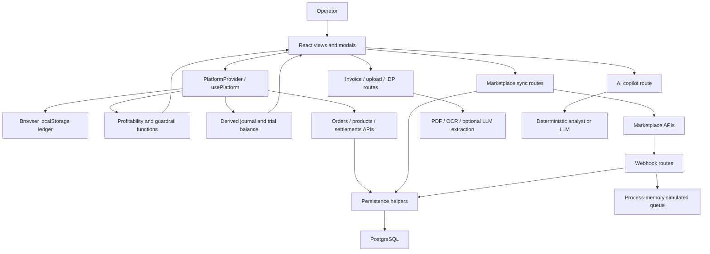

# MarginFlow: project architecture and functionality analysis

Analysis date: 14 October 2026. This describes the current working tree, including existing uncommitted changes, rather than only the committed repository.

## Scope and verification limits

The review inventoried and parsed all 147 first-party TypeScript, TSX, and CSS source files (approximately 49,000 lines), mapped local dependencies and routes, and traced the central store, financial engines, authentication, persistence, integrations, imports, documents, and operational views. The file inventory below identifies every source file and its entry points. Database scripts, tests, configuration, and project documents were also inspected for architecture and consistency.

This is a repository-wide architecture and functionality review, not a claim that every line has been independently proved correct. Live merchant accounts, external API permissions, deployed database migrations, browser interactions, and production infrastructure were not exercised. Dependency internals, generated build output, binary brand assets, and the contents of private invoice PDFs are outside the source review. Environment secret values were not printed.

No application code, UI, financial formulas, database records, or existing user changes were intentionally modified. This report is the only authored project artifact.

## Product and implementation shape

MarginFlow is an e-commerce financial operations workspace for brand owners, suppliers, and wholesalers. Its intended purpose is to connect orders, product acquisition costs, returns, marketplace deductions, payouts, claims, and overheads into an understandable view of profitability. It also provides import assistance, operational alerts, a derived general ledger, and an AI assistant.

The implementation is a single Next.js App Router application. The presentation layer is predominantly client-rendered React. A root React Context provider holds the operational datasets and exposes mutation actions and computed metrics. Server route handlers provide database access, authentication, external API proxies, credential storage, and document extraction.

The code has a recognizable separation between domain logic, server libraries, and components. That separation is incomplete: financial and state-transition logic also lives in views and modals, and there is no single durable service layer used by every mutation.

| Layer | Primary location | Responsibility |
|---|---|---|
| Routes and application shell | `src/app` | Landing, login, onboarding, dashboard routes, API handlers, errors and loading |
| Domain models and state | `src/domain/types.ts`, `src/domain/store.tsx` | Entities, lifecycle states, datasets, actions, filters, computed summaries |
| Financial calculations | `src/domain/profitability-engine.ts`, `ledger-engine.ts` | Business/order/channel/SKU metrics, return impact, aging, journal and trial balance |
| Import and document logic | `csv-auto-mapper.ts`, `ocr-engine.ts`, `idp-pipeline.ts`, `src/lib/ocr` | File parsing, format detection, extraction, catalog matching, staging |
| Server infrastructure | `src/lib/db.ts`, `src/lib/integrations`, `src/lib/security`, `src/lib/queue` | SQL access, upserts, vaults, sessions, webhook verification, queues |
| Product UI | `src/components/modules`, `modals`, `layout`, `ui`, `ai` | Operational screens, forms, tables, alerts, assistant |
| Database assets | `database` | Schema, enums, indexes, triggers, computed views, seeds, later migrations |
| Specifications and checks | Root Markdown, `tests` | Product intent, calculation rules, UI invariants, historical audit claims, tests |

The stack includes Next.js 15, React 19, strict TypeScript, Tailwind 3, TanStack Table, Recharts, Lucide, PostgreSQL through `pg`, XLSX parsing, PDF text extraction, Tesseract, Zod, and the AI SDK with Google and OpenAI-compatible providers. The installed Next.js build identifies version 15.5.25. There is no Supabase client or Redis/BullMQ dependency in the application manifest.

## Runtime and data flow

The provider wraps even landing and login pages. On mount it reads `marginflow_session` and the shared `MARGINFLOW_PERSISTENT_LEDGER_V3` cache. It then asks `/api/auth/me` for an authenticated server session and fetches up to 2,000 orders and settlements plus products. Nonempty server arrays replace their corresponding client arrays. Empty arrays leave the cache intact.

Client dataset changes are serialized after an 800 ms debounce, with `requestIdleCallback` used when available. Selected marketplace and date filters drive memoized business metrics. Date presets use the latest order date as their anchor, with a fixed fallback date. Individual modules also apply their own filters and calculations.

The route shell supplies persistent sidebar/navbar navigation, mobile sidebar behavior, Ctrl/Cmd+B, route scroll reset, a lazy-loaded Flow assistant, and a global dispute modal. The assistant supports Ctrl/Cmd+J. Many modals are dynamically imported and rendered through body portals.

## Entity model

The main entities are Product, HistoricalCost, Order, OrderItem, ReturnRecord, Settlement, SettlementDeduction, Claim, Supplier, PurchaseBill, Expense, AIStagedDocument, FinancialAuditLog, CustomerComplaint, and UserAccount.

Orders contain line items with historical unit-cost snapshots. Returns link to both internal and channel order references plus a SKU. Claims may link to an order and a return. Settlements link to an order and a batch and contain deduction lines and statutory withholding amounts. Products carry historical costs, marketplace aliases, supplier references, and stock quantities. Expenses can be attributed to a marketplace and SKU.

IDs cross two representations: display IDs in the client and UUIDs in PostgreSQL. API mappers translate between them. Marketplace names also cross representations: Shopify connections use `Shopify`, while Shopify orders use `Personal Website`. Correct identity mapping is therefore central to reconciliation, deduplication, and tenancy.

## Functionality inventory

| Area | Implemented behavior | Current constraints |
|---|---|---|
| Landing | Marketing sections, FAQ, contact form, entry links | Contact submission only changes local success state; a landing sign-in handler creates a dummy browser session |
| Login and onboarding | Email signup/login, role selection, onboarding preferences | Google UI sends no ID token; profile/preferences mostly remain browser-local |
| Dashboard | Operator/CFO modes, profit cards, channels, SKU ranking, loss alerts, CSV export, date range controls, calculation explanations | Uses different calculation paths from SKU economics and some other reports |
| Orders | Manual creation/edit, search, dates, status/channel filters, bulk actions, CSV/XLSX import, invoice parsing, unit-economics breakdown | Most edits/deletes/status transitions do not persist to the server |
| Returns | Linked-order or direct-SKU entry, RTO/customer/damage classification, QC changes, stock restoration, claims, aging, export | State transitions can treat a partial return as an entire returned order; aging uses a fixed simulation date |
| Claims | Claim listing/editing, recovery entry, status filtering, bulk deletion, breakdowns, dispute narrative generation | Claims are client-local; filing records a claim inside MarginFlow and does not submit it to a marketplace |
| Products | Catalog creation, SKU/MFN autofill, bulk upload, aliases, cost revision and history, deletion | Server product hydration drops history/aliases; revisions and deletions are not durably synchronized |
| Settlements | Manual payout entry, deductions, arithmetic mismatch flagging, aging inspection | Uses one-order-oriented replacement in the client; multiple payout events/batches require care |
| Suppliers | Directory, contact validation, purchase/COGS attribution, balances, payout recording | Client-local; payment allocation iterates the current array without enforcing chronological FIFO or tracking per-bill paid amounts |
| Purchases | Supplier invoice entry, quantity/cost/tax totals, bill list, paid supplier aggregation | Adding a purchase does not itself increase catalog stock or revise cost history |
| Expenses | Create/edit/delete/bulk delete, categories, marketplace/SKU attribution | Client-local; recurrence is metadata rather than a scheduler |
| Reports | Analytics/P&L tabs, products, channel comparisons, returns, monthly trends, CSV export | Several charts use raw all-time arrays while other cards use filtered store metrics |
| General ledger | Generated journal entries, account search, reference filters, trial balance | Recomputed from mutable operational arrays; not an independently persisted posting ledger |
| Integrations | Credential forms, server vault metadata, connection tests, manual order sync, webhook instructions, report import | Pagination, frontend vault reuse, tenant webhook routing, and truthful success reporting are incomplete |
| Notifications | Derived deadline, settlement, stock, return inspection and other alerts, read/dismiss state | Derived client state rather than a durable notification service; some timestamps are presentation placeholders |
| Flow assistant | Local keyword triage, deterministic answers, optional streaming LLM responses, navigation/SKU/claim action chips, anomaly radar | Client supplies the financial context; numeric grounding inherits the current engine's inconsistencies |
| AI settings | BYOK providers, key masking/purge, model discovery, connection tests, custom endpoint | AI keys remain in browser storage, unlike marketplace credentials; custom endpoints reach the server network |
| Document staging | Extraction confidence/provenance, math checks, edits, approval/rejection, batch staging | Component exists but `/documents` redirects to `/orders`; audit view is also not routed |
| Recycle bin | Tabs, recovery countdowns and restore UI | Includes demo deleted records; restore hides an item and shows success without restoring store/database data |
| Background jobs | Enqueue/list/status/cancel APIs | Work is simulated; registry and timers exist only in the running process |

## Financial model as implemented

The business engine excludes cancelled orders, sums invoice gross sales and discounts, classifies returned orders, chooses a payout amount, subtracts active COGS and customer-return fees, adds eligible recoveries, and then subtracts operating expenses. Advertising is a subset of expenses for ROAS/POAS.

For a delivered or partial-return order, payout priority is linked settlements, explicit settlement amount, settlement percentage, estimated marketplace deductions, then 75% of gross sales. The result is exposed as `actualSettlementsReceived` even when it came from an estimate. Good full returns/RTO generally zero the payout and COGS; damaged returns retain COGS. RTO fees are forced to zero in these paths.

The SKU engine follows another model: selling price less discounts and refunds, less COGS for units excluding good returns, less allocated estimated fees and return fees, plus allocated recoveries. It does not receive settlements at all. It also recognizes positive recovery amounts without applying the same status gate as the business/order engine.

`computeReturnFinancials` separately includes damage cost, salvage, reverse shipping, processing fees, and matched reimbursement. The business/order engine does not consistently use this full return-impact calculation. SQL profitability views provide another implementation and are not the normal dashboard's calculation source.

Actual-function probes, executed without changing source, demonstrate these differences:

| Probe | Business | Order | SKU |
|---|---:|---:|---:|
| Two units at ₹100, ₹20 line discount, ₹40 unit cost, no settlement: reported net sales | ₹180 | ₹200 | ₹180 |
| Same order: contribution profit | ₹70 | ₹70 | ₹100 |
| Partial good return of one unit: COGS | ₹80 | ₹80 | ₹40 |

The unsettled business/order payout in the first probe is ₹150, produced by the 75% fallback, not a bank receipt.

The journal engine creates debit/credit legs for orders, settlements, returns, purchases, and expenses. Estimated fees are split 65% commission and 35% logistics. Claims and supplier payments are absent from its function inputs. A cancelled-order probe still produced a balanced journal recognizing ₹200 revenue. Arithmetic balance therefore does not establish correct economic treatment. Return entries also lack a full customer-revenue refund reversal, and purchase payments are not comprehensively cleared against accounts payable.

## Persistence and security boundaries

| Dataset or operation | Actual persistence path |
|---|---|
| Orders | PostgreSQL writes on add/external sync; client-local edits, status changes and deletions |
| Products | PostgreSQL writes on add/bulk add; client-local cost revisions, inventory changes and deletions |
| Settlements | PostgreSQL writes on add/external sync |
| Returns, claims, suppliers, purchases, expenses, complaints | Primarily provider state and browser ledger; matching SQL tables do not make the UI mutations persistent |
| Audit | Client audit arrays plus separate SQL audit inserts for ingestion; no unified hydrate/read path |
| Documents | Files in local private directory; partial SQL staging persistence and separate client staging state |
| Marketplace credentials | AES-256-GCM encrypted SQL records, with a process-memory fallback |
| AI credentials | Plain browser localStorage settings, transmitted in requests to provider proxies |
| Jobs, webhook replay cache, rate limits | Process-memory structures |

Server sessions are HMAC-SHA256 signed tokens in HTTP-only cookies with expiry, secure production cookies, and constant-time signature comparison. Passwords use salted PBKDF2-SHA512. Many order/product/settlement/connection routes derive tenant IDs from verified sessions. Webhooks verify raw-body HMAC with provider schemas and a replay cache. Upload files are outside `public`, and document streaming requires authentication. WooCommerce and generic sync perform outbound URL validation.

These mechanisms are useful foundations, but the whole application does not yet share those boundaries consistently. Authentication is not the same as role authorization, and the client account role does not constitute server authorization. The Supabase RLS script grants most business-table access to any authenticated Supabase user; it does not enforce row ownership. The application uses custom sessions and direct `pg`, not a Supabase authenticated client.

## Significant findings grounded in current code

1. **Password login accepts passwordless rows.** `src/app/api/auth/login/route.ts:39` verifies a password only when `password_hash` is present. A Google-created account without a hash can therefore receive a signed session through email login with any nonempty password. `auth-crypto.ts:8` also uses only 1,000 iterations, below the repository's own evaluation target.

2. **Browser ledger isolation is incomplete.** `store.tsx:56` uses one global cache key. `refreshFromDatabase` leaves cached arrays intact on empty results, and only fetches three datasets. On a shared browser or account transition, the UI can retain prior-account data. The server session response is not used to replace `currentUser` in that refresh path.

3. **Webhook tenant routing is not bound to the verified store.** Shopify and WooCommerce use environment-level secrets and take `user_id` from the request query, defaulting to `ACC-001` (`shopify/route.ts:98`, `woocommerce/route.ts:103`). The signed body does not bind that query tenant. There is no store-to-owner lookup in this path.

4. **Private files are authenticated but not owner-authorized.** `documents/stream/route.ts` checks a session, then serves a filename from a shared directory without a tenant ownership lookup. The OCR extractor's product lookup and staged-document insert also lack user ownership parameters.

5. **Database failures can become false success.** `order-persistence.ts:205` and `:376` increment inserted counts after caught write failures. Counts are also adjusted before commit. Failed transaction/audit operations may be swallowed. A connection failure can fall back to nontransactional pool queries. The calling API can then report success despite no durable import.

6. **Most CRUD is not durable.** The store's fetch calls cover additions/sync for only three datasets. A reload can restore server versions after local edits/deletes, while other entity types remain browser-only. Product/stock mutations across linked actions are not one database transaction.

7. **Batch merge indexes become stale.** `syncExternalOrders` and `syncExternalSettlements` index the existing array, then prepend new records without adjusting indexes. An actual extracted-updater probe with existing A, incoming new B, then updated A placed A's customer details onto B and left A unchanged. Matching keys also omit marketplace identity.

8. **Financial views disagree.** The probes above confirm inconsistent discounts, good-return COGS and settlement estimates. Business metrics return `refundedSales` as customer-return fees, keep `outstandingSettlementEstimated` at zero, and do not fully reverse returned sales in `netSales`.

9. **Financial guesswork remains.** CSV mapping substitutes ₹999 when selling price is absent/zero (`csv-auto-mapper.ts:500`); invoice parsing uses channel commission defaults; Shopify/WooCommerce mapping estimates 2% gateway fees; Shopify assigns ₹80 shipping. Staging approval hardcodes ₹380 cost (`store.tsx:1901`) and dispute drafting falls back to ₹450 (`dispute-packet-modal.tsx:56`). These contradict broad zero-guesswork claims in project documents.

10. **Cost snapshots and product hydration are not complete end to end.** API-ingested lines often use zero cost without catalog resolution. SQL prevents later snapshot updates. Product GET omits required `costHistory` and `channelAliases`; `updateProductCost` calls `p.costHistory.map`, creating a possible runtime failure after server hydration. Product POST also omits supplier/history/alias persistence.

11. **Partial-return and claim transitions affect whole orders.** `addReturn` changes the order to RTO/customer-return/claim-pending regardless of remaining delivered units. Claim recovery also changes the whole order status, including claims such as fee disputes. Return edits do not comprehensively recalculate related order quantities and status. Restocking lacks a store-level already-restocked guard.

12. **Guardrails diagnose more than they enforce.** The diagnostic checks warn about over-returns and recoveries; not every mutation blocks those states. Staged-document approval does not itself enforce arithmetic success or prevent reapproval. UI gates and store invariants are different things.

13. **Connector completeness is overstated.** Amazon exposes one orders page and cursor, but the integration UI does not drain pagination. WooCommerce/Shopify fetch one page. Flipkart fetches one page and maps each source row to a one-line order, rather than grouping all lines by order. Genuine production credentials/permissions were not tested here.

14. **Server integration capability is not fully wired into the UI.** Flipkart OAuth routes and Amazon finance ingestion exist, but the integrations view does not call them. UI sync handlers require credentials in form state after secrets have been stripped from stored metadata. Generic sync does not retrieve vaulted credentials. Vault-save response errors are not checked before the UI announces success.

15. **Amazon finance events are not bank deposits.** The mapper handles shipment events and computes a net amount, rather than validating an actual payout transaction. It puts withholding into deduction lines as well as `tcsTdsTax`, while settlement balance guardrails subtract both. Other financial event families are not comprehensively processed.

16. **Queue and generic webhook processing are incomplete.** `REDIS_URL` sets a boolean but activates no Redis worker. Jobs simulate progress/results, including a report URL without producing the file. Generic webhook ingestion only enqueues this simulated work, so it has no durable order persistence path.

17. **Replay handling can lose retries.** Events are marked before schema validation/persistence. A failed event can be treated as already ingested on retry. The cache is neither durable nor tenant-scoped, and expiry is only pruned after its size exceeds 10,000. Timestamp verification is defined but not invoked by the Shopify route.

18. **Some public server routes lack equivalent controls.** Jobs list/detail/cancel/enqueue, AI copilot, AI provider discovery, IDP extraction and DB health have no session check. The health route returns cross-tenant sample profitability. Custom AI endpoints are fetched without the SSRF guard, and some LLM routes can use a server environment key. This was found by source review, not by attempting exploitation.

19. **Dates and filters have multiple meanings.** Dashboard presets anchor to the latest order; returns aging uses 17 September 2026; notifications use wall-clock time. Related datasets are independently filtered by their own dates, so a payout/return/claim for an older order can be detached from that order's financial context. Reports mix filtered metrics and raw arrays.

20. **Database initialization has drifted.** `00_run_all.sql` runs steps 01–06 and omits later integration, notification, OAuth, import-audit and tenant migrations. Runtime auto-migration adds tenant indexes but does not remove all old global uniqueness constraints. Step 13 drops old global order indexes and product SKU uniqueness, but global display-ID uniqueness remains. Its optional staged-document ownership check targets `staged_documents`, while the core schema uses `ai_staged_documents`. The consolidated setup and numbered files are separate maintenance surfaces. Actual applied database state remains unverified.

21. **Reachability and marketing claims need distinction.** `/documents` redirects to orders, `/audit` redirects to dashboard, the staging/audit components are unreferenced, and several landing components are unused alternatives. Recycle-bin restore is simulated. A function or SQL table existing does not establish an available, complete product workflow.

## Testing and build evidence

| Check | Result |
|---|---|
| `npx tsc --noEmit --incremental false` | Passed, exit 0 |
| `node --test tests/*.test.mjs` | 140 tests: 130 pass, 10 fail |
| `node --experimental-strip-types --test --test-reporter=spec tests/*.test.mjs` | 140 tests: 135 pass, 5 fail |
| `npm run build` | Failed: Google Fonts DNS resolution (`fonts.googleapis.com`) and EPERM creating `.next/types/app/api/auth` |
| Actual financial-function probes | Confirmed inconsistent profit/COGS and cancelled-order journal behavior |
| Actual extracted order-sync updater probe | Confirmed incorrect target update after prepending a new order |

The TypeScript stripping flag resolves five direct `.ts` import failures under Node 22.14.0. Three remaining tests expect old, non-tenant SQL conflict targets even though the current code includes `user_id`. Two remaining tests assert dashboard heading and landing grid patterns that the current UI no longer contains. These are failing checks; they are not evidence that all affected implementations are broken in the same way.

Most test cases inspect strings or source patterns. Some behavioral tests reproduce simplified logic instead of calling the full application implementation. They do not establish live API compatibility, database transaction correctness, browser tenancy isolation, financial reconciliation across views, or concurrency safety. The package's `npm test` script runs only `ui-ux-analyst.test.mjs`, not the whole suite.

A passing TypeScript check is narrower than a successful production build. Runtime warnings and full production rendering cannot be certified from this build attempt.

## Maintenance context

The largest source files are the integration screen (2,755 lines), central store (2,328), orders (1,956), dashboard (1,924), returns (1,687), and profitability engine (1,422). The store has broad responsibilities and one large context object, so dataset changes can rerender many consumers. Indexed maps, memoization, deferred searches, lazy modal imports, and local persistence debouncing are already present; other reports and supplier calculations still contain repeated scans.

`AGENTS.md` and `UI_UX_STANDARDS.md` govern minimal modifications and modal behavior. Most modal components include portals, mounted guards, Escape handling and backdrop dismissal. Source inspection also found native `window.confirm` workflows, a legacy CSS backdrop with 8px blur, and `backdrop-blur-xs` without a corresponding custom Tailwind blur scale. Visual compliance was not validated in a browser during this analysis.

The PRD, Features, logic, guardrails, AI infrastructure, workflow, evaluations, positioning/research, prior audits, integration plan and remediation log are valuable context, but mix intent, historical observations and completion assertions. Current source and executed checks take precedence when describing behavior. Supabase Realtime, durable distributed jobs, comprehensive owner policies and several production-complete claims are not substantiated by the current implementation.

## Working understanding for subsequent changes

The central dependency chain is entity model → store actions → calculations → views, with selected additions and imports crossing into server persistence. Changes to an order or return must be checked against inventory, claim state, payout matching, SKU economics, dashboard summaries and the derived ledger. Changes to a server mapper must also preserve display/UUID identity, marketplace naming, tenant routing, cost snapshots and error reporting.

The project has substantial operational UI and reusable domain code, but the production boundary is incomplete. Its most consequential gaps are consistent financial semantics, durable CRUD, authenticated ownership across all paths, truthful ingestion outcomes and complete connector orchestration. No remediation was undertaken as part of this understanding task.

## File inventory

The following inventory is generated from the current source and configuration. Entry points are structural evidence, not a guarantee of live functionality. Unreferenced means no resolved local import in the scanned application; route files remain framework entry points.

### API route inventory

| Route | Methods | Access control observed |
|---|---|---|
| `/api/ai-copilot` | POST | No session check in handler |
| `/api/ai-dispute` | POST | No session check in handler |
| `/api/ai-vault` | POST | No session check in handler |
| `/api/auth/google` | POST | No session check in handler |
| `/api/auth/login` | POST | No session check in handler |
| `/api/auth/logout` | POST | No session check in handler |
| `/api/auth/me` | GET | Session checked |
| `/api/auth/signup` | POST | No session check in handler |
| `/api/documents/stream` | GET | Session checked |
| `/api/extract-invoice-text` | POST | Session checked |
| `/api/health/db` | GET | No session check in handler |
| `/api/idp-extract` | POST | No session check in handler |
| `/api/integrations/amazon/finances` | POST | Session checked |
| `/api/integrations/amazon/sync` | POST | Session checked |
| `/api/integrations/connections` | GET, POST, DELETE | Session checked |
| `/api/integrations/flipkart/callback` | GET, POST | OAuth state checked |
| `/api/integrations/flipkart/connect` | GET, POST | Session checked |
| `/api/integrations/flipkart/sync` | POST | Session checked |
| `/api/integrations/generic/sync` | POST | Session checked |
| `/api/integrations/meesho/sync` | POST | No session check in handler |
| `/api/integrations/myntra/sync` | POST | No session check in handler |
| `/api/integrations/reports/upload` | POST, GET | Session checked |
| `/api/integrations/shopify/sync` | POST | Session checked |
| `/api/integrations/woocommerce/sync` | POST | Session checked |
| `/api/jobs/[id]` | GET, DELETE | No session check in handler |
| `/api/jobs` | POST, GET | No session check in handler |
| `/api/orders` | GET, POST | Session checked |
| `/api/products` | GET, POST | Session checked |
| `/api/settlements` | GET, POST | Session checked |
| `/api/upload-bill` | POST | Session checked |
| `/api/webhooks/generic` | POST | Webhook HMAC; ping shortcut |
| `/api/webhooks/shopify` | POST | Webhook HMAC; ping shortcut |
| `/api/webhooks/woocommerce` | POST | Webhook HMAC; ping shortcut |

### All application source files

| File | Lines | Exported entry points | Local dependency count |
|---|---:|---|---:|
| [src/app/(dashboard)/claims/page.tsx](<C:/Users/freak/Desktop/Unified platform/src/app/(dashboard)/claims/page.tsx>) | 8 | ClaimsPage | 1 |
| [src/app/(dashboard)/dashboard/page.tsx](<C:/Users/freak/Desktop/Unified platform/src/app/(dashboard)/dashboard/page.tsx>) | 8 | DashboardPage | 1 |
| [src/app/(dashboard)/documents/page.tsx](<C:/Users/freak/Desktop/Unified platform/src/app/(dashboard)/documents/page.tsx>) | 6 | DocumentsPage | 0 |
| [src/app/(dashboard)/expenses/page.tsx](<C:/Users/freak/Desktop/Unified platform/src/app/(dashboard)/expenses/page.tsx>) | 8 | ExpensesPage | 1 |
| [src/app/(dashboard)/layout.tsx](<C:/Users/freak/Desktop/Unified platform/src/app/(dashboard)/layout.tsx>) | 148 | DashboardLayout | 6 |
| [src/app/(dashboard)/ledger/page.tsx](<C:/Users/freak/Desktop/Unified platform/src/app/(dashboard)/ledger/page.tsx>) | 8 | LedgerPage | 1 |
| [src/app/(dashboard)/loading.tsx](<C:/Users/freak/Desktop/Unified platform/src/app/(dashboard)/loading.tsx>) | 64 | DashboardLoading | 0 |
| [src/app/(dashboard)/orders/page.tsx](<C:/Users/freak/Desktop/Unified platform/src/app/(dashboard)/orders/page.tsx>) | 8 | OrdersPage | 1 |
| [src/app/(dashboard)/products/page.tsx](<C:/Users/freak/Desktop/Unified platform/src/app/(dashboard)/products/page.tsx>) | 8 | ProductsPage | 1 |
| [src/app/(dashboard)/purchases/page.tsx](<C:/Users/freak/Desktop/Unified platform/src/app/(dashboard)/purchases/page.tsx>) | 8 | PurchasesPage | 1 |
| [src/app/(dashboard)/reports/page.tsx](<C:/Users/freak/Desktop/Unified platform/src/app/(dashboard)/reports/page.tsx>) | 8 | ReportsPage | 1 |
| [src/app/(dashboard)/returns/page.tsx](<C:/Users/freak/Desktop/Unified platform/src/app/(dashboard)/returns/page.tsx>) | 8 | ReturnsPage | 1 |
| [src/app/(dashboard)/settlements/page.tsx](<C:/Users/freak/Desktop/Unified platform/src/app/(dashboard)/settlements/page.tsx>) | 8 | SettlementsPage | 1 |
| [src/app/(dashboard)/suppliers/page.tsx](<C:/Users/freak/Desktop/Unified platform/src/app/(dashboard)/suppliers/page.tsx>) | 8 | SuppliersPage | 1 |
| [src/app/(dashboard)/trash/page.tsx](<C:/Users/freak/Desktop/Unified platform/src/app/(dashboard)/trash/page.tsx>) | 8 | TrashPage | 1 |
| [src/app/(dashboard)/webhooks/page.tsx](<C:/Users/freak/Desktop/Unified platform/src/app/(dashboard)/webhooks/page.tsx>) | 8 | WebhooksPage | 1 |
| [src/app/api/ai-copilot/route.ts](<C:/Users/freak/Desktop/Unified platform/src/app/api/ai-copilot/route.ts>) | 357 | POST | 3 |
| [src/app/api/ai-dispute/route.ts](<C:/Users/freak/Desktop/Unified platform/src/app/api/ai-dispute/route.ts>) | 148 | DisputePacketPayload, POST | 1 |
| [src/app/api/ai-vault/route.ts](<C:/Users/freak/Desktop/Unified platform/src/app/api/ai-vault/route.ts>) | 341 | NormalizedModel, POST | 1 |
| [src/app/api/auth/google/route.ts](<C:/Users/freak/Desktop/Unified platform/src/app/api/auth/google/route.ts>) | 179 | POST | 2 |
| [src/app/api/auth/login/route.ts](<C:/Users/freak/Desktop/Unified platform/src/app/api/auth/login/route.ts>) | 114 | POST | 3 |
| [src/app/api/auth/logout/route.ts](<C:/Users/freak/Desktop/Unified platform/src/app/api/auth/logout/route.ts>) | 15 | POST | 1 |
| [src/app/api/auth/me/route.ts](<C:/Users/freak/Desktop/Unified platform/src/app/api/auth/me/route.ts>) | 62 | GET | 2 |
| [src/app/api/auth/signup/route.ts](<C:/Users/freak/Desktop/Unified platform/src/app/api/auth/signup/route.ts>) | 122 | POST | 3 |
| [src/app/api/documents/stream/route.ts](<C:/Users/freak/Desktop/Unified platform/src/app/api/documents/stream/route.ts>) | 90 | GET | 1 |
| [src/app/api/extract-invoice-text/route.ts](<C:/Users/freak/Desktop/Unified platform/src/app/api/extract-invoice-text/route.ts>) | 410 | POST | 1 |
| [src/app/api/health/db/route.ts](<C:/Users/freak/Desktop/Unified platform/src/app/api/health/db/route.ts>) | 62 | GET | 1 |
| [src/app/api/idp-extract/route.ts](<C:/Users/freak/Desktop/Unified platform/src/app/api/idp-extract/route.ts>) | 29 | POST | 1 |
| [src/app/api/integrations/amazon/finances/route.ts](<C:/Users/freak/Desktop/Unified platform/src/app/api/integrations/amazon/finances/route.ts>) | 371 | POST | 5 |
| [src/app/api/integrations/amazon/sync/route.ts](<C:/Users/freak/Desktop/Unified platform/src/app/api/integrations/amazon/sync/route.ts>) | 466 | POST | 7 |
| [src/app/api/integrations/connections/route.ts](<C:/Users/freak/Desktop/Unified platform/src/app/api/integrations/connections/route.ts>) | 136 | GET, POST, DELETE | 2 |
| [src/app/api/integrations/flipkart/callback/route.ts](<C:/Users/freak/Desktop/Unified platform/src/app/api/integrations/flipkart/callback/route.ts>) | 296 | GET, POST | 3 |
| [src/app/api/integrations/flipkart/connect/route.ts](<C:/Users/freak/Desktop/Unified platform/src/app/api/integrations/flipkart/connect/route.ts>) | 125 | GET, POST | 3 |
| [src/app/api/integrations/flipkart/sync/route.ts](<C:/Users/freak/Desktop/Unified platform/src/app/api/integrations/flipkart/sync/route.ts>) | 446 | POST | 6 |
| [src/app/api/integrations/generic/sync/route.ts](<C:/Users/freak/Desktop/Unified platform/src/app/api/integrations/generic/sync/route.ts>) | 268 | POST | 8 |
| [src/app/api/integrations/meesho/sync/route.ts](<C:/Users/freak/Desktop/Unified platform/src/app/api/integrations/meesho/sync/route.ts>) | 25 | POST | 1 |
| [src/app/api/integrations/myntra/sync/route.ts](<C:/Users/freak/Desktop/Unified platform/src/app/api/integrations/myntra/sync/route.ts>) | 37 | POST | 1 |
| [src/app/api/integrations/reports/upload/route.ts](<C:/Users/freak/Desktop/Unified platform/src/app/api/integrations/reports/upload/route.ts>) | 158 | POST, GET | 4 |
| [src/app/api/integrations/shopify/sync/route.ts](<C:/Users/freak/Desktop/Unified platform/src/app/api/integrations/shopify/sync/route.ts>) | 255 | POST | 6 |
| [src/app/api/integrations/woocommerce/sync/route.ts](<C:/Users/freak/Desktop/Unified platform/src/app/api/integrations/woocommerce/sync/route.ts>) | 285 | POST | 8 |
| [src/app/api/jobs/[id]/route.ts](<C:/Users/freak/Desktop/Unified platform/src/app/api/jobs/[id]/route.ts>) | 36 | GET, DELETE | 1 |
| [src/app/api/jobs/route.ts](<C:/Users/freak/Desktop/Unified platform/src/app/api/jobs/route.ts>) | 42 | POST, GET | 2 |
| [src/app/api/orders/route.ts](<C:/Users/freak/Desktop/Unified platform/src/app/api/orders/route.ts>) | 199 | GET, POST | 4 |
| [src/app/api/products/route.ts](<C:/Users/freak/Desktop/Unified platform/src/app/api/products/route.ts>) | 176 | GET, POST | 3 |
| [src/app/api/settlements/route.ts](<C:/Users/freak/Desktop/Unified platform/src/app/api/settlements/route.ts>) | 176 | GET, POST | 4 |
| [src/app/api/upload-bill/route.ts](<C:/Users/freak/Desktop/Unified platform/src/app/api/upload-bill/route.ts>) | 191 | POST | 2 |
| [src/app/api/webhooks/generic/route.ts](<C:/Users/freak/Desktop/Unified platform/src/app/api/webhooks/generic/route.ts>) | 124 | POST | 6 |
| [src/app/api/webhooks/shopify/route.ts](<C:/Users/freak/Desktop/Unified platform/src/app/api/webhooks/shopify/route.ts>) | 130 | POST | 7 |
| [src/app/api/webhooks/woocommerce/route.ts](<C:/Users/freak/Desktop/Unified platform/src/app/api/webhooks/woocommerce/route.ts>) | 135 | POST | 7 |
| [src/app/error.tsx](<C:/Users/freak/Desktop/Unified platform/src/app/error.tsx>) | 46 | ErrorBoundary | 0 |
| [src/app/global-error.tsx](<C:/Users/freak/Desktop/Unified platform/src/app/global-error.tsx>) | 32 | GlobalError | 1 |
| [src/app/globals.css](<C:/Users/freak/Desktop/Unified platform/src/app/globals.css>) | 227 | Styles / internal module | 0 |
| [src/app/layout.tsx](<C:/Users/freak/Desktop/Unified platform/src/app/layout.tsx>) | 48 | metadata, RootLayout | 2 |
| [src/app/login/page.tsx](<C:/Users/freak/Desktop/Unified platform/src/app/login/page.tsx>) | 371 | LoginPage | 2 |
| [src/app/onboarding/page.tsx](<C:/Users/freak/Desktop/Unified platform/src/app/onboarding/page.tsx>) | 460 | OnboardingPage | 1 |
| [src/app/page.tsx](<C:/Users/freak/Desktop/Unified platform/src/app/page.tsx>) | 220 | LandingPage | 7 |
| [src/components/MarginFlowLogo.tsx](<C:/Users/freak/Desktop/Unified platform/src/components/MarginFlowLogo.tsx>) | 117 | MarginFlowLogoProps, MarginFlowLogo | 0 |
| [src/components/ai/ai-settings-modal.tsx](<C:/Users/freak/Desktop/Unified platform/src/components/ai/ai-settings-modal.tsx>) | 640 | AISettingsModal | 1 |
| [src/components/ai/assistant-emblem.tsx](<C:/Users/freak/Desktop/Unified platform/src/components/ai/assistant-emblem.tsx>) | 10 | AssistantEmblem | 1 |
| [src/components/ai/cfo-copilot.tsx](<C:/Users/freak/Desktop/Unified platform/src/components/ai/cfo-copilot.tsx>) | 721 | CfoCopilot | 10 |
| [src/components/landing/alternating-engines.tsx](<C:/Users/freak/Desktop/Unified platform/src/components/landing/alternating-engines.tsx>) | 355 | AlternatingEngines | 0 |
| [src/components/landing/glowing-spectrum.tsx](<C:/Users/freak/Desktop/Unified platform/src/components/landing/glowing-spectrum.tsx>) | 238 | GlowingSpectrum | 0 |
| [src/components/landing/hairline-leak-grid.tsx](<C:/Users/freak/Desktop/Unified platform/src/components/landing/hairline-leak-grid.tsx>) | 225 | HairlineLeakGrid | 0 |
| [src/components/landing/hero-apparatus.tsx](<C:/Users/freak/Desktop/Unified platform/src/components/landing/hero-apparatus.tsx>) | 321 | HeroApparatus | 0 |
| [src/components/landing/hero-conveyor.tsx](<C:/Users/freak/Desktop/Unified platform/src/components/landing/hero-conveyor.tsx>) | 385 | HeroConveyorVisual | 0 |
| [src/components/landing/isometric-features.tsx](<C:/Users/freak/Desktop/Unified platform/src/components/landing/isometric-features.tsx>) | 332 | IsometricFeatures | 0 |
| [src/components/landing/margin-leak-spectrum.tsx](<C:/Users/freak/Desktop/Unified platform/src/components/landing/margin-leak-spectrum.tsx>) | 234 | MarginLeakSpectrum | 0 |
| [src/components/landing/marginflow-compound-metrics.tsx](<C:/Users/freak/Desktop/Unified platform/src/components/landing/marginflow-compound-metrics.tsx>) | 389 | MarginFlowCompoundMetrics | 0 |
| [src/components/landing/marginflow-flow-machine.tsx](<C:/Users/freak/Desktop/Unified platform/src/components/landing/marginflow-flow-machine.tsx>) | 262 | MarginFlowFlowMachine | 0 |
| [src/components/landing/marginflow-footer.tsx](<C:/Users/freak/Desktop/Unified platform/src/components/landing/marginflow-footer.tsx>) | 113 | MarginFlowFooterProps, MarginFlowFooter | 1 |
| [src/components/landing/marginflow-hero.tsx](<C:/Users/freak/Desktop/Unified platform/src/components/landing/marginflow-hero.tsx>) | 356 | MarginFlowHeroProps, MarginFlowHero | 0 |
| [src/components/landing/marginflow-marquee.tsx](<C:/Users/freak/Desktop/Unified platform/src/components/landing/marginflow-marquee.tsx>) | 91 | MarginFlowBrandMarquee | 0 |
| [src/components/landing/marginflow-navbar.tsx](<C:/Users/freak/Desktop/Unified platform/src/components/landing/marginflow-navbar.tsx>) | 286 | MarginFlowNavbarProps, MarginFlowNavbar | 1 |
| [src/components/landing/marginflow-route-comparison.tsx](<C:/Users/freak/Desktop/Unified platform/src/components/landing/marginflow-route-comparison.tsx>) | 529 | MarginFlowRouteComparison | 0 |
| [src/components/landing/marginflow-workspace-showcase.tsx](<C:/Users/freak/Desktop/Unified platform/src/components/landing/marginflow-workspace-showcase.tsx>) | 233 | MarginFlowWorkspaceShowcase | 0 |
| [src/components/layout/navbar.tsx](<C:/Users/freak/Desktop/Unified platform/src/components/layout/navbar.tsx>) | 138 | Navbar | 5 |
| [src/components/layout/notification-bell.tsx](<C:/Users/freak/Desktop/Unified platform/src/components/layout/notification-bell.tsx>) | 704 | AppNotification, NotificationBell | 1 |
| [src/components/layout/sidebar.tsx](<C:/Users/freak/Desktop/Unified platform/src/components/layout/sidebar.tsx>) | 404 | NavModule, Sidebar | 3 |
| [src/components/modals/add-purchase-modal.tsx](<C:/Users/freak/Desktop/Unified platform/src/components/modals/add-purchase-modal.tsx>) | 246 | AddPurchaseModalProps, AddPurchaseModal | 2 |
| [src/components/modals/card-logic-modal.tsx](<C:/Users/freak/Desktop/Unified platform/src/components/modals/card-logic-modal.tsx>) | 358 | CardLogicModalData, CardLogicModalProps, CardLogicModal, getCardLogicDefinitions | 2 |
| [src/components/modals/claim-breakdown-modal.tsx](<C:/Users/freak/Desktop/Unified platform/src/components/modals/claim-breakdown-modal.tsx>) | 476 | ClaimCardType, ClaimBreakdownModalProps, ClaimBreakdownModal | 2 |
| [src/components/modals/csv-import-modal.tsx](<C:/Users/freak/Desktop/Unified platform/src/components/modals/csv-import-modal.tsx>) | 562 | CsvImportModalProps, CsvImportModal | 4 |
| [src/components/modals/dispute-packet-modal.tsx](<C:/Users/freak/Desktop/Unified platform/src/components/modals/dispute-packet-modal.tsx>) | 356 | DisputePacketModal | 3 |
| [src/components/modals/invoice-auto-parse-modal.tsx](<C:/Users/freak/Desktop/Unified platform/src/components/modals/invoice-auto-parse-modal.tsx>) | 962 | InvoiceAutoParseModalProps, InvoiceAutoParseModal | 5 |
| [src/components/modals/order-modal.tsx](<C:/Users/freak/Desktop/Unified platform/src/components/modals/order-modal.tsx>) | 1047 | OrderModalProps, OrderModal | 3 |
| [src/components/modals/product-bulk-upload-modal.tsx](<C:/Users/freak/Desktop/Unified platform/src/components/modals/product-bulk-upload-modal.tsx>) | 586 | ProductBulkUploadModalProps, ProductBulkUploadModal | 2 |
| [src/components/modals/record-return-modal.tsx](<C:/Users/freak/Desktop/Unified platform/src/components/modals/record-return-modal.tsx>) | 277 | RecordReturnModalProps, RecordReturnModal | 1 |
| [src/components/modals/return-breakdown-modal.tsx](<C:/Users/freak/Desktop/Unified platform/src/components/modals/return-breakdown-modal.tsx>) | 775 | ReturnCardType, ReturnBreakdownModalProps, ReturnBreakdownModal | 3 |
| [src/components/modals/sku-drawer.tsx](<C:/Users/freak/Desktop/Unified platform/src/components/modals/sku-drawer.tsx>) | 324 | SkuEconomicsItem, SkuDrawerProps, SkuDrawer | 1 |
| [src/components/modals/supplier-modal.tsx](<C:/Users/freak/Desktop/Unified platform/src/components/modals/supplier-modal.tsx>) | 589 | SupplierModalProps, SupplierModal | 1 |
| [src/components/modals/user-profile-modal.tsx](<C:/Users/freak/Desktop/Unified platform/src/components/modals/user-profile-modal.tsx>) | 415 | UserProfileModalProps, UserProfileModal | 1 |
| [src/components/modules/ai-staging-view.tsx](<C:/Users/freak/Desktop/Unified platform/src/components/modules/ai-staging-view.tsx>) | 1182 | AIStagingView | 4 |
| [src/components/modules/audit-view.tsx](<C:/Users/freak/Desktop/Unified platform/src/components/modules/audit-view.tsx>) | 222 | AuditView | 4 |
| [src/components/modules/claims-view.tsx](<C:/Users/freak/Desktop/Unified platform/src/components/modules/claims-view.tsx>) | 720 | ClaimsView | 5 |
| [src/components/modules/dashboard-view.tsx](<C:/Users/freak/Desktop/Unified platform/src/components/modules/dashboard-view.tsx>) | 1924 | DashboardView | 7 |
| [src/components/modules/expenses-view.tsx](<C:/Users/freak/Desktop/Unified platform/src/components/modules/expenses-view.tsx>) | 717 | ExpensesView | 4 |
| [src/components/modules/ledger-view.tsx](<C:/Users/freak/Desktop/Unified platform/src/components/modules/ledger-view.tsx>) | 407 | LedgerView | 3 |
| [src/components/modules/orders-view.tsx](<C:/Users/freak/Desktop/Unified platform/src/components/modules/orders-view.tsx>) | 1957 | OrdersView | 9 |
| [src/components/modules/products-view.tsx](<C:/Users/freak/Desktop/Unified platform/src/components/modules/products-view.tsx>) | 728 | ProductsView | 5 |
| [src/components/modules/purchases-view.tsx](<C:/Users/freak/Desktop/Unified platform/src/components/modules/purchases-view.tsx>) | 126 | PurchasesView | 5 |
| [src/components/modules/recycle-bin-view.tsx](<C:/Users/freak/Desktop/Unified platform/src/components/modules/recycle-bin-view.tsx>) | 400 | RecycleBinView | 1 |
| [src/components/modules/reports-view.tsx](<C:/Users/freak/Desktop/Unified platform/src/components/modules/reports-view.tsx>) | 1038 | ReportsView | 3 |
| [src/components/modules/returns-view.tsx](<C:/Users/freak/Desktop/Unified platform/src/components/modules/returns-view.tsx>) | 1688 | ReturnsView | 7 |
| [src/components/modules/settlements-view.tsx](<C:/Users/freak/Desktop/Unified platform/src/components/modules/settlements-view.tsx>) | 673 | SettlementsView | 5 |
| [src/components/modules/suppliers-view.tsx](<C:/Users/freak/Desktop/Unified platform/src/components/modules/suppliers-view.tsx>) | 929 | SuppliersView | 4 |
| [src/components/modules/webhook-simulator.tsx](<C:/Users/freak/Desktop/Unified platform/src/components/modules/webhook-simulator.tsx>) | 2756 | WebhookSimulatorView | 5 |
| [src/components/ui/data-table.tsx](<C:/Users/freak/Desktop/Unified platform/src/components/ui/data-table.tsx>) | 296 | DataTable | 0 |
| [src/components/ui/infinity-loop.tsx](<C:/Users/freak/Desktop/Unified platform/src/components/ui/infinity-loop.tsx>) | 42 | Styles / internal module | 1 |
| [src/components/ui/marketplace-dropdown.tsx](<C:/Users/freak/Desktop/Unified platform/src/components/ui/marketplace-dropdown.tsx>) | 330 | FormMarketplaceDropdown, PlatformFilterOption, PlatformFilterDropdown, MarketplaceBadge | 2 |
| [src/domain/ai-context.ts](<C:/Users/freak/Desktop/Unified platform/src/domain/ai-context.ts>) | 249 | AIActionChip, GroundedFinancialContext, serializeFinancialContext, CFO_SYSTEM_PROMPT | 2 |
| [src/domain/anomaly-radar.ts](<C:/Users/freak/Desktop/Unified platform/src/domain/anomaly-radar.ts>) | 272 | AnomalyCategory, AnomalySeverity, AnomalyReportItem, AnomalyRadarBriefing, computeAnomalyRadar | 2 |
| [src/domain/csv-auto-mapper.ts](<C:/Users/freak/Desktop/Unified platform/src/domain/csv-auto-mapper.ts>) | 579 | MarketplaceSheetFormat, TargetFieldDef, TARGET_FIELDS, AutoMappedColumn, FormatDetectionResult, CsvMappingResult, parseRawCsv, cleanCurrency, cleanDate, normalizeOrderStatus, findHeaderRow, detectFormatSignature, autoMapColumns, detectAndMapCsv | 2 |
| [src/domain/deterministic-analyst.ts](<C:/Users/freak/Desktop/Unified platform/src/domain/deterministic-analyst.ts>) | 283 | AnalystResponse, analyzeFinancialQuery, parseResponseAndChips | 2 |
| [src/domain/guardrails.ts](<C:/Users/freak/Desktop/Unified platform/src/domain/guardrails.ts>) | 221 | runSystemGuardrailDiagnostics, validateDocumentArithmetic | 1 |
| [src/domain/idp-pipeline.ts](<C:/Users/freak/Desktop/Unified platform/src/domain/idp-pipeline.ts>) | 238 | LineItemSchema, IDPLineItem, InvoiceExtractionSchema, IDPInvoiceExtraction, IDPPipelineResult, executeIDPPipeline | 3 |
| [src/domain/ledger-engine.ts](<C:/Users/freak/Desktop/Unified platform/src/domain/ledger-engine.ts>) | 573 | AccountType, AccountDefinition, CHART_OF_ACCOUNTS, JournalPostingLine, JournalEntry, TrialBalanceRow, TrialBalance, validateJournalBalance, generateGeneralLedger, calculateTrialBalance | 1 |
| [src/domain/mock-data.ts](<C:/Users/freak/Desktop/Unified platform/src/domain/mock-data.ts>) | 89 | INITIAL_SUPPLIERS, INITIAL_PRODUCTS, INITIAL_ORDERS, INITIAL_RETURNS, INITIAL_CLAIMS, INITIAL_SETTLEMENTS, INITIAL_PURCHASES, INITIAL_EXPENSES, INITIAL_AI_DOCUMENTS, INITIAL_AUDIT_LOGS, INITIAL_COMPLAINTS, DEFAULT_ACCOUNTS | 1 |
| [src/domain/ocr-engine.ts](<C:/Users/freak/Desktop/Unified platform/src/domain/ocr-engine.ts>) | 284 | OCRResult, processDocumentOCR, generateSampleBillText | 2 |
| [src/domain/profitability-engine.ts](<C:/Users/freak/Desktop/Unified platform/src/domain/profitability-engine.ts>) | 1422 | ProfitabilityMetrics, OrderProfitability, SkuProfitability, MarketplaceProfitability, MonthlyProfitability, IndexedFinancialMaps, buildFinancialMaps, getReturnedUnitsForItem, getGoodReturnedUnitsForItem, getRefundedAmountForItem, calculateBusinessProfitability, calculateOrderProfitability, calculateMarketplaceProfitability, calculateSkuProfitability, ReturnFinancials, computeReturnFinancials, DateRangePreset, DateFilterRange, MetricTrend, resolveDatePreset, filterDatasetByDateRange, calculatePercentageChange, SettlementAgingBracket, SettlementAgingSummary, calculateSettlementAging | 1 |
| [src/domain/store.tsx](<C:/Users/freak/Desktop/Unified platform/src/domain/store.tsx>) | 2329 | LEDGER_STORAGE_KEY, PlatformProvider, usePlatform | 4 |
| [src/domain/types.ts](<C:/Users/freak/Desktop/Unified platform/src/domain/types.ts>) | 446 | Marketplace, OrderStatus, ReturnType, ProductCondition, ClaimStatus, DeductionCategory, ReconciliationStatus, ProvenanceType, ExpenseCategory, HistoricalCost, Product, OrderItem, Order, RestockStatus, ReturnRecord, SettlementDeduction, Settlement, Claim, Supplier, PurchaseBill, Expense, ExtractedField, AIStagedDocument, FinancialAuditLog, GuardrailCheckResult, InventoryMetrics, FeesBreakdown, ClaimsSummary, SettlementSummary, ComplaintCategory, ComplaintPriority, ComplaintStatus, CustomerComplaint, AccountType, OnboardingPreferences, UserAccount, SyncStatus, SyncErrorItem, MarketplaceSyncResult | 0 |
| [src/lib/auth-crypto.ts](<C:/Users/freak/Desktop/Unified platform/src/lib/auth-crypto.ts>) | 23 | hashPassword, verifyPassword | 0 |
| [src/lib/db.ts](<C:/Users/freak/Desktop/Unified platform/src/lib/db.ts>) | 168 | query, ensureMarketplaceTables | 0 |
| [src/lib/integrations/error-response.ts](<C:/Users/freak/Desktop/Unified platform/src/lib/integrations/error-response.ts>) | 43 | MarketplaceErrorEnvelope, marketplaceError | 2 |
| [src/lib/integrations/file-audit.ts](<C:/Users/freak/Desktop/Unified platform/src/lib/integrations/file-audit.ts>) | 203 | FileImportAuditParams, FileImportLogRecord, calculateFileHash, recordFileImportAudit, getFileImportHistory | 1 |
| [src/lib/integrations/order-persistence.ts](<C:/Users/freak/Desktop/Unified platform/src/lib/integrations/order-persistence.ts>) | 387 | OrderPersistenceResult, SettlementPersistenceResult, upsertOrders, upsertSettlements | 2 |
| [src/lib/integrations/sync-contract.ts](<C:/Users/freak/Desktop/Unified platform/src/lib/integrations/sync-contract.ts>) | 107 | SyncStatus, SyncErrorItem, MarketplaceSyncResult, MarketplaceSyncEnvelope, buildSyncResult, syncSuccessResponse | 1 |
| [src/lib/marketplace-config.tsx](<C:/Users/freak/Desktop/Unified platform/src/lib/marketplace-config.tsx>) | 215 | AmazonLogo, FlipkartLogo, MyntraLogo, MeeshoLogo, WooCommerceLogo, ShopifyLogo, B2BWholesaleLogo, MarketplaceLogoComponent, MarketplaceConfigItem, MARKETPLACE_CONFIGS, ALL_MARKETPLACES, MARKETPLACE_LIST, normalizeMarketplace, getMarketplaceBadge | 1 |
| [src/lib/navigation-config.ts](<C:/Users/freak/Desktop/Unified platform/src/lib/navigation-config.ts>) | 131 | ModuleNavigationMeta, MODULE_NAVIGATION_CONFIG, getModuleNavMeta | 0 |
| [src/lib/ocr/extractor.ts](<C:/Users/freak/Desktop/Unified platform/src/lib/ocr/extractor.ts>) | 241 | DocumentExtractionResult, extractTextFromBuffer, processAndStageDocument | 4 |
| [src/lib/queue/queue-manager.ts](<C:/Users/freak/Desktop/Unified platform/src/lib/queue/queue-manager.ts>) | 178 | queueManager | 1 |
| [src/lib/queue/types.ts](<C:/Users/freak/Desktop/Unified platform/src/lib/queue/types.ts>) | 30 | JobType, JobStatus, Job, EnqueueJobOptions | 0 |
| [src/lib/security/ai-vault.ts](<C:/Users/freak/Desktop/Unified platform/src/lib/security/ai-vault.ts>) | 391 | AIProvider, ProviderMeta, PROVIDER_REGISTRY, AISettings, DiscoveredModel, getCachedModels, setCachedModels, fetchLiveModels, verifyConnection, loadAISettings, saveAISettings, purgeAISettings, maskKey | 0 |
| [src/lib/security/encryption.ts](<C:/Users/freak/Desktop/Unified platform/src/lib/security/encryption.ts>) | 103 | encryptPayload, decryptPayload | 0 |
| [src/lib/security/idempotency.ts](<C:/Users/freak/Desktop/Unified platform/src/lib/security/idempotency.ts>) | 56 | checkAndMarkEventIdempotency | 0 |
| [src/lib/security/marketplace-vault.ts](<C:/Users/freak/Desktop/Unified platform/src/lib/security/marketplace-vault.ts>) | 379 | VaultedConnectionMetadata, SaveConnectionParams, getConnectionsForUser, saveConnection, getConnectionCredentials, disconnectConnection, updateSyncStatus, recordSyncLog | 2 |
| [src/lib/security/oauth-state.ts](<C:/Users/freak/Desktop/Unified platform/src/lib/security/oauth-state.ts>) | 148 | createOAuthState, verifyAndConsumeOAuthState | 1 |
| [src/lib/security/rate-limiter.ts](<C:/Users/freak/Desktop/Unified platform/src/lib/security/rate-limiter.ts>) | 117 | RateLimitResult, TokenBucketRateLimiter, amazonSpApiLimiter, marketplaceSyncLimiter, webhookIngestionLimiter | 0 |
| [src/lib/security/redactor.ts](<C:/Users/freak/Desktop/Unified platform/src/lib/security/redactor.ts>) | 80 | redactSensitiveData, formatSafeErrorResponse | 0 |
| [src/lib/security/secret-vault.ts](<C:/Users/freak/Desktop/Unified platform/src/lib/security/secret-vault.ts>) | 68 | WebhookSecrets, getWebhookSecret | 0 |
| [src/lib/security/session.ts](<C:/Users/freak/Desktop/Unified platform/src/lib/security/session.ts>) | 246 | SESSION_COOKIE_NAME, DEFAULT_SESSION_EXPIRY_SECONDS, SessionPayload, signSessionToken, verifySessionToken, getSessionUser, getSessionUserId, getSessionCookieOptions | 0 |
| [src/lib/security/ssrf-guard.ts](<C:/Users/freak/Desktop/Unified platform/src/lib/security/ssrf-guard.ts>) | 256 | SsrValidationResult, validateSafeOutboundUrl, safeOutboundFetch | 0 |
| [src/lib/security/webhook-verifier.ts](<C:/Users/freak/Desktop/Unified platform/src/lib/security/webhook-verifier.ts>) | 183 | VerificationResult, verifyShopifyWebhook, verifyWooCommerceWebhook, verifyGenericWebhook, verifyTimestampFreshness | 0 |
| [src/lib/utils.ts](<C:/Users/freak/Desktop/Unified platform/src/lib/utils.ts>) | 32 | cn, formatINR, formatPercent, formatDate | 0 |
| [src/lib/webhooks/schemas/generic-schema.ts](<C:/Users/freak/Desktop/Unified platform/src/lib/webhooks/schemas/generic-schema.ts>) | 85 | GenericOrderItemSchema, GenericOrderWebhookSchema, GenericOrderWebhookPayload, mapGenericOrderToDomain | 1 |
| [src/lib/webhooks/schemas/shopify-schema.ts](<C:/Users/freak/Desktop/Unified platform/src/lib/webhooks/schemas/shopify-schema.ts>) | 107 | ShopifyLineItemSchema, ShopifyOrderWebhookSchema, ShopifyOrderWebhookPayload, mapShopifyOrderToDomain | 1 |
| [src/lib/webhooks/schemas/woocommerce-schema.ts](<C:/Users/freak/Desktop/Unified platform/src/lib/webhooks/schemas/woocommerce-schema.ts>) | 105 | WooLineItemSchema, WooCommerceOrderWebhookSchema, WooCommerceOrderWebhookPayload, mapWooCommerceOrderToDomain | 1 |

### Unreferenced non-route source files

- [src/components/landing/alternating-engines.tsx](<C:/Users/freak/Desktop/Unified platform/src/components/landing/alternating-engines.tsx>)
- [src/components/landing/glowing-spectrum.tsx](<C:/Users/freak/Desktop/Unified platform/src/components/landing/glowing-spectrum.tsx>)
- [src/components/landing/hairline-leak-grid.tsx](<C:/Users/freak/Desktop/Unified platform/src/components/landing/hairline-leak-grid.tsx>)
- [src/components/landing/hero-apparatus.tsx](<C:/Users/freak/Desktop/Unified platform/src/components/landing/hero-apparatus.tsx>)
- [src/components/landing/hero-conveyor.tsx](<C:/Users/freak/Desktop/Unified platform/src/components/landing/hero-conveyor.tsx>)
- [src/components/landing/isometric-features.tsx](<C:/Users/freak/Desktop/Unified platform/src/components/landing/isometric-features.tsx>)
- [src/components/landing/margin-leak-spectrum.tsx](<C:/Users/freak/Desktop/Unified platform/src/components/landing/margin-leak-spectrum.tsx>)
- [src/components/landing/marginflow-marquee.tsx](<C:/Users/freak/Desktop/Unified platform/src/components/landing/marginflow-marquee.tsx>)
- [src/components/modals/record-return-modal.tsx](<C:/Users/freak/Desktop/Unified platform/src/components/modals/record-return-modal.tsx>)
- [src/components/modules/ai-staging-view.tsx](<C:/Users/freak/Desktop/Unified platform/src/components/modules/ai-staging-view.tsx>)
- [src/components/modules/audit-view.tsx](<C:/Users/freak/Desktop/Unified platform/src/components/modules/audit-view.tsx>)

### Database files

| File | Role / defined objects |
|---|---|
| [database/00_run_all.sql](<C:/Users/freak/Desktop/Unified platform/database/00_run_all.sql>) | Setup runner / migration / database documentation |
| [database/01_enums.sql](<C:/Users/freak/Desktop/Unified platform/database/01_enums.sql>) | marketplace_enum, order_status_enum, return_type_enum, product_condition_enum, restock_status_enum, claim_status_enum, claim_type_enum, deduction_category_enum, reconciliation_status_enum, payment_status_enum, payment_method_enum, expense_category_enum, ai_document_type_enum, ai_document_status_enum, provenance_enum, audit_entity_type_enum, complaint_category_enum, complaint_priority_enum, complaint_status_enum, account_type_enum, job_type_enum, job_status_enum |
| [database/02_tables.sql](<C:/Users/freak/Desktop/Unified platform/database/02_tables.sql>) | user_accounts, suppliers, supplier_payments, products, product_cost_history, product_channel_aliases, orders, order_items, return_records, claims, claim_documents, settlements, settlement_deductions, purchase_bills, expenses, ai_staged_documents, ai_staged_fields, financial_audit_logs, customer_complaints, background_jobs |
| [database/03_indexes.sql](<C:/Users/freak/Desktop/Unified platform/database/03_indexes.sql>) | Setup runner / migration / database documentation |
| [database/04_triggers.sql](<C:/Users/freak/Desktop/Unified platform/database/04_triggers.sql>) | fn_block_audit_log_mutations, fn_block_snapshot_cost_update, fn_set_updated_at, fn_sync_supplier_total_paid, fn_close_previous_cost_window, fn_sync_product_current_cost |
| [database/05_views.sql](<C:/Users/freak/Desktop/Unified platform/database/05_views.sql>) | v_order_profitability, v_sku_profitability, v_marketplace_profitability, v_settlement_aging, v_inventory_metrics, v_claims_summary |
| [database/06_seed.sql](<C:/Users/freak/Desktop/Unified platform/database/06_seed.sql>) | Setup runner / migration / database documentation |
| [database/07_rls_supabase.sql](<C:/Users/freak/Desktop/Unified platform/database/07_rls_supabase.sql>) | fn_is_authenticated, fn_handle_new_auth_user |
| [database/08_webhooks_notifications_softdelete.sql](<C:/Users/freak/Desktop/Unified platform/database/08_webhooks_notifications_softdelete.sql>) | webhook_source_enum, webhook_status_enum, notification_type_enum, notification_severity_enum, webhook_events, notifications, v_unread_notification_count, v_recycle_bin |
| [database/09_marketplace_connections.sql](<C:/Users/freak/Desktop/Unified platform/database/09_marketplace_connections.sql>) | marketplace_connections, marketplace_sync_logs |
| [database/10_orders_idempotency.sql](<C:/Users/freak/Desktop/Unified platform/database/10_orders_idempotency.sql>) | Setup runner / migration / database documentation |
| [database/11_oauth_states.sql](<C:/Users/freak/Desktop/Unified platform/database/11_oauth_states.sql>) | oauth_states |
| [database/12_file_import_audit.sql](<C:/Users/freak/Desktop/Unified platform/database/12_file_import_audit.sql>) | file_import_logs |
| [database/13_multitenant_isolation.sql](<C:/Users/freak/Desktop/Unified platform/database/13_multitenant_isolation.sql>) | Setup runner / migration / database documentation |
| [database/README.md](<C:/Users/freak/Desktop/Unified platform/database/README.md>) | MarginFlow Database Setup Guide |
| [database/database-explained.md](<C:/Users/freak/Desktop/Unified platform/database/database-explained.md>) | MarginFlow — Database Explained in Plain English |
| [database/database-tutorial.md](<C:/Users/freak/Desktop/Unified platform/database/database-tutorial.md>) | MarginFlow: Complete PostgreSQL Setup & Connection Guide |
| [database/marginflow_complete_setup.sql](<C:/Users/freak/Desktop/Unified platform/database/marginflow_complete_setup.sql>) | marketplace_enum, order_status_enum, return_type_enum, product_condition_enum, restock_status_enum, claim_status_enum, claim_type_enum, deduction_category_enum, reconciliation_status_enum, payment_status_enum, payment_method_enum, expense_category_enum, ai_document_type_enum, ai_document_status_enum, provenance_enum, audit_entity_type_enum, complaint_category_enum, complaint_priority_enum, complaint_status_enum, account_type_enum, job_type_enum, job_status_enum, webhook_source_enum, webhook_status_enum, notification_type_enum, notification_severity_enum, user_accounts, suppliers, supplier_payments, products, product_cost_history, product_channel_aliases, orders, order_items, return_records, claims, claim_documents, settlements, settlement_deductions, purchase_bills, expenses, ai_staged_documents, ai_staged_fields, financial_audit_logs, customer_complaints, background_jobs, webhook_events, notifications, fn_set_updated_at, fn_block_audit_log_mutations, fn_block_snapshot_cost_update, fn_sync_supplier_total_paid, fn_close_previous_cost_window, fn_sync_product_current_cost, v_order_profitability, v_sku_profitability, v_marketplace_profitability, v_settlement_aging, v_inventory_metrics, v_claims_summary, v_unread_notification_count, v_recycle_bin |

### Test files

| File | Suite |
|---|---|
| [tests/phase1-security.test.mjs](<C:/Users/freak/Desktop/Unified platform/tests/phase1-security.test.mjs>) | Phase 1 Security & Identity Hardening Test Suite |
| [tests/phase2-multitenancy.test.mjs](<C:/Users/freak/Desktop/Unified platform/tests/phase2-multitenancy.test.mjs>) | Phase 2 Database Multi-Tenancy & Single Source of Truth Test Suite |
| [tests/phase3-persistence-ledger.test.mjs](<C:/Users/freak/Desktop/Unified platform/tests/phase3-persistence-ledger.test.mjs>) | Phase 3 Transactional Persistence, Queues & Financial Ledger Rigor Test Suite |
| [tests/store-integration-phase1.test.mjs](<C:/Users/freak/Desktop/Unified platform/tests/store-integration-phase1.test.mjs>) | Store Integration Phase 1 Verification Suite |
| [tests/store-integration-phase2.test.mjs](<C:/Users/freak/Desktop/Unified platform/tests/store-integration-phase2.test.mjs>) | Store Integration Phase 2 Verification Suite |
| [tests/store-integration-phase3.test.mjs](<C:/Users/freak/Desktop/Unified platform/tests/store-integration-phase3.test.mjs>) | Store Integration Phase 3 Verification Suite |
| [tests/store-integration-phase4.test.mjs](<C:/Users/freak/Desktop/Unified platform/tests/store-integration-phase4.test.mjs>) | Store Integration Phase 4 Verification Suite |
| [tests/store-integration-phase5.test.mjs](<C:/Users/freak/Desktop/Unified platform/tests/store-integration-phase5.test.mjs>) | Store Integration Phase 5 Verification Suite |
| [tests/store-integration-phase6.test.mjs](<C:/Users/freak/Desktop/Unified platform/tests/store-integration-phase6.test.mjs>) | Store Integration Phase 6 Verification Suite: Unified Contract & 10-Point  |
| [tests/ui-ux-analyst.test.mjs](<C:/Users/freak/Desktop/Unified platform/tests/ui-ux-analyst.test.mjs>) | UI/UX Analyst Verification Test Suite |

### Project documents and root configuration

| File | Purpose / title |
|---|---|
| [.gitignore](<C:/Users/freak/Desktop/Unified platform/.gitignore>) | Generated/dependency/environment ignore patterns |
| [AGENTS.md](<C:/Users/freak/Desktop/Unified platform/AGENTS.md>) | Project Rules & Development Guidelines: MarginFlow |
| [AI_INFRA.md](<C:/Users/freak/Desktop/Unified platform/AI_INFRA.md>) | AI Architecture & Capabilities Specification (`AI_INFRA.md`) |
| [EVALS.md](<C:/Users/freak/Desktop/Unified platform/EVALS.md>) | MarginFlow System Evaluation Specification (EVALS) |
| [Features.md](<C:/Users/freak/Desktop/Unified platform/Features.md>) | Platform Features & Architecture Specification |
| [GEMINI.md](<C:/Users/freak/Desktop/Unified platform/GEMINI.md>) | Project Rules & Development Guidelines: MarginFlow |
| [GUARDRAILS.md](<C:/Users/freak/Desktop/Unified platform/GUARDRAILS.md>) | Project notes |
| [MATHEMATICAL_AUDIT_REPORT.md](<C:/Users/freak/Desktop/Unified platform/MATHEMATICAL_AUDIT_REPORT.md>) | Comprehensive Mathematical & Financial Audit Report: MarginFlow |
| [PRD.md](<C:/Users/freak/Desktop/Unified platform/PRD.md>) | Product Requirements Document (PRD): MarginFlow |
| [README.md](<C:/Users/freak/Desktop/Unified platform/README.md>) | Margin-Flow |
| [STORE_INTEGRATION_PLAN.md](<C:/Users/freak/Desktop/Unified platform/STORE_INTEGRATION_PLAN.md>) | MarginFlow Store Integration — Production Architecture & Execution Plan |
| [SUPABASE_PHASE_2_PLAN.md](<C:/Users/freak/Desktop/Unified platform/SUPABASE_PHASE_2_PLAN.md>) | MarginFlow — Supabase Phase 2 Production Architecture Plan |
| [UI_UX_STANDARDS.md](<C:/Users/freak/Desktop/Unified platform/UI_UX_STANDARDS.md>) | UI & UX Standards and Design System: MarginFlow |
| [logic.md](<C:/Users/freak/Desktop/Unified platform/logic.md>) | MarginFlow Financial Logic & Calculation Engine Specification (`logic.md`) |
| [next-env.d.ts](<C:/Users/freak/Desktop/Unified platform/next-env.d.ts>) | Generated Next TypeScript environment declarations |
| [next.config.mjs](<C:/Users/freak/Desktop/Unified platform/next.config.mjs>) | Next build/import settings, React Strict Mode disabled, /audit redirect |
| [package-lock.json](<C:/Users/freak/Desktop/Unified platform/package-lock.json>) | Resolved dependency lockfile; dependency internals not audited |
| [package.json](<C:/Users/freak/Desktop/Unified platform/package.json>) | Dependencies and dev/build/start/lint/test commands |
| [positioning.md](<C:/Users/freak/Desktop/Unified platform/positioning.md>) | MarginFlow — Strategic Market Positioning, Marketing Page Analysis & Product Reality Blueprint |
| [postcss.config.js](<C:/Users/freak/Desktop/Unified platform/postcss.config.js>) | Tailwind and Autoprefixer pipeline |
| [research.md](<C:/Users/freak/Desktop/Unified platform/research.md>) | Project notes |
| [skills-lock.json](<C:/Users/freak/Desktop/Unified platform/skills-lock.json>) | Installed skill metadata |
| [tailwind.config.js](<C:/Users/freak/Desktop/Unified platform/tailwind.config.js>) | Design tokens, fonts, neutral elevation, utility safelists |
| [tsconfig.json](<C:/Users/freak/Desktop/Unified platform/tsconfig.json>) | Strict TypeScript, path aliases, Next types, incremental build configuration |
| [tsconfig.tsbuildinfo](<C:/Users/freak/Desktop/Unified platform/tsconfig.tsbuildinfo>) | Generated TypeScript cache; not business source |
| [workflow.md](<C:/Users/freak/Desktop/Unified platform/workflow.md>) | MarginFlow — System Architecture & Operational Workflow |

### Binary assets and generated/external content

The source branding assets are `src/margin flow logo.png` and the PNG/SVG logo/icon variants under `public/`. Two invoice PDFs are currently stored under `data/secure-vault/documents/`; their contents were not inspected. `node_modules`, `.next`, build caches, Git internals and environment values are not application functionality to be treated as first-party source. Existing public PDF deletions and other working-tree modifications predate this review.
